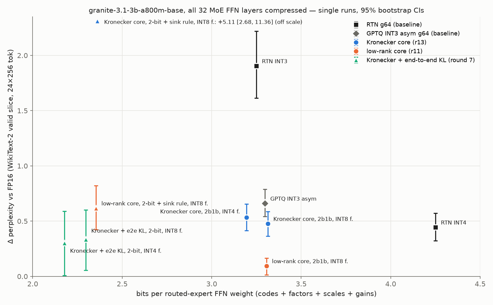
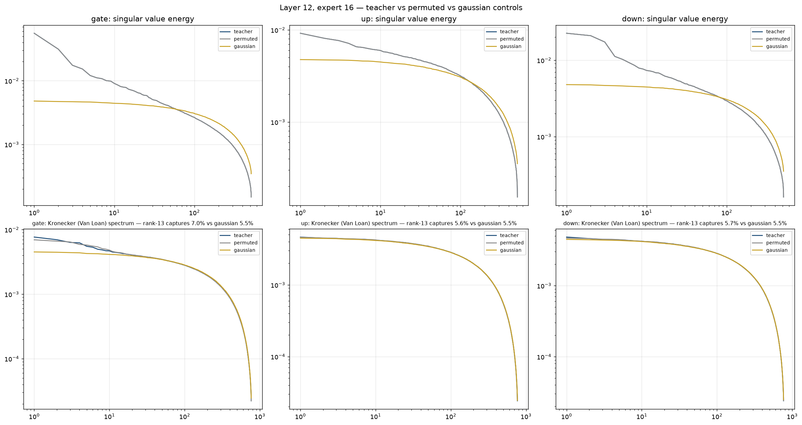
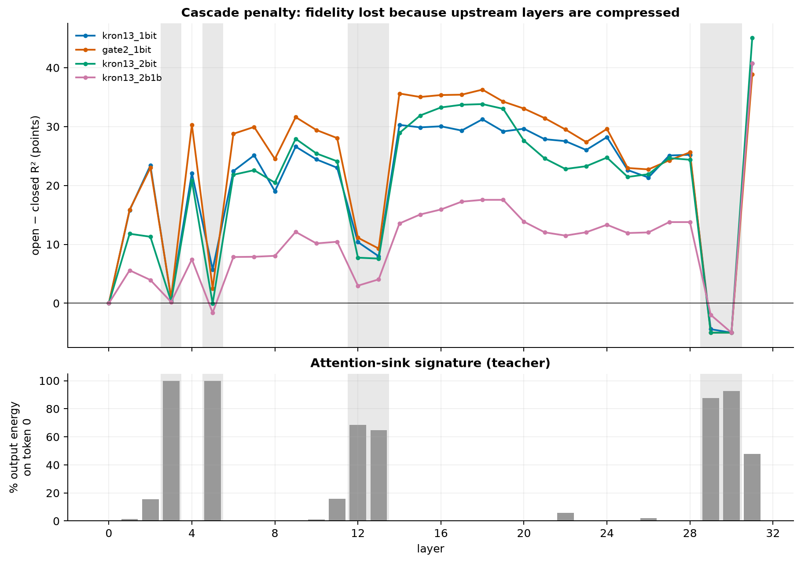

# Low-rank core + Hadamard-rotated GPTQ residual for MoE FFN compression (2026-11)

**Summary.** We compressed every routed-expert FFN matrix of `ibm-granite/granite-3.1-3b-a800m-base` (32 MoE
layers, 40 experts each) as *core + residual*: a small structured core stored as INT8 factors, plus a 2- or 3-bit
residual coded in a Hadamard-rotated basis with GPTQ rounding, fitted layer by layer to the original model's FFN
outputs. A plain low-rank core (rank 11) with a 2-bit + 1-bit residual reached **ΔPPL +0.095 [0.014, 0.166] at
3.306 bits per weight**, against +0.445 [0.324, 0.571] for RTN INT4 at 4.25 bpw in the same run, with the same
next-token KL to FP16 (0.0906 vs 0.0912 per token). The Kronecker core this project started from did clearly worse
at matched bits (paired −0.382 [−0.473, −0.296] in favour of low rank) and was only marginally better than plain
GPTQ INT3 with no core at all. These are single runs on one model and a small evaluation set: a strong preliminary
result that needs replication (see Limitations and [NEXT_STEPS.md](NEXT_STEPS.md)).

| configuration (all 32 FFN layers) | bpw | ΔPPL [95% CI] | top-1 % | KL/token |
|---|---|---|---|---|
| FP16 reference (PPL 6.929) | 16 | 0 | 100 | 0 |
| RTN INT4, group 64 | 4.25 | +0.445 [0.324, 0.571] | 88.42 | 0.0912 |
| RTN INT3, group 64 | 3.25 | +1.905 [1.615, 2.218] | 76.78 | 0.3466 |
| GPTQ INT3 asym, group 64, no core (damp selected on calibration) | 3.297 | +0.661 [0.542, 0.789] | 84.61 | 0.1461 |
| Kronecker core r13 + 2b1b GPTQ residual, INT8 factors | 3.314 | +0.478 [0.365, 0.588] | 86.19 | 0.1362 |
| **Low-rank core r11 + 2b1b GPTQ residual, INT8 factors** | **3.306** | **+0.095 [0.014, 0.166]** | 87.32 | 0.0906 |
| Low-rank core r11 + 2-bit GPTQ residual + sink rule, INT8 factors ¹ | 2.353 | +0.618 [0.425, 0.821] | 80.95 | 0.2187 |
| Kronecker core r13 + 2-bit GPTQ residual + end-to-end KL, INT4 factors ² | 2.178 | +0.301 [0.009, 0.59] | 79.98 | 0.2587 |

Rows without a footnote come from one run (round 8 v3). ¹ Round 8 v4; same-run RTN INT4 +0.446 [0.326, 0.57], and
the paired difference to it is +0.172 [−0.088, 0.425] (not significant). ² Round 7; same-run RTN INT4 +0.439
[0.318, 0.564]; top-1 and KL from re-scoring the saved checkpoints (`results/agreement_r5_r6_r7.json`). This model
matches RTN INT4 on perplexity but is **not** INT4-equivalent as a distribution: its KL is about 2.8× higher and
top-1 about 8 points lower.

**Measurement.** Evaluation text is 24 sequences × 256 tokens of WikiText-2 *validation*; calibration is the first
48 × 256 tokens of the same file, and the eval slice starts 4 sequences later (disjoint but adjacent, same
articles). ΔPPL is against the same run's FP16 model. CIs are 95% bootstrap over sequences; "paired" means both
rows are resampled on the same sequences. bpw counts every stored byte of the routed-expert FFN weights: residual
codes, core factors (with one fp16 scale per factor term when quantized), row/column scales, residual gains and the
output gain. Routers, attention, embeddings and norms stay FP16 and are not counted. All runs: one Tesla V100-PCIE-32GB.

## Method

For each MoE layer, in order (closed loop: each layer is fitted on inputs produced by the already-compressed
preceding layers), every expert matrix W (gate, up, down) is stored as

  W ≈ (C + g₂ ⊙ R₂ + g₁ ⊙ R₁) ⊙ (r cᵀ)

- **Scales** r, c: per-row and per-column scales that balance W after weighting columns by input activation RMS.
- **Core** C: either a sum of 13 Kronecker products Aᵢ ⊗ Bᵢ (A 32×32), initialized from the SVD of the
  Van Loan rearrangement of the balanced weight, or a sum of 11 outer products uᵢvᵢᵀ initialized from its
  truncated SVD. Rank 11 is the largest low-rank whose INT8 factor cost does not exceed that of Kronecker rank 13
  (0.230 vs 0.238 bpw). Both are the same code path (`LowRankMixin` in `scripts/rpm_ihog_round8.py` sets the
  Kronecker block shapes to p₁ = d_out, q₁ = 1).
- **Residual** R = H_out · Q · H_in: the remainder W/(r cᵀ) − C is rotated by block-Hadamard matrices on both sides
  and quantized to 4 Lloyd-Max Gaussian levels (2 bits), optionally plus a 1-bit sign stage on the remaining error
  ("2b1b", 3 bits). Codes are chosen by GPTQ/LDLQ using per-expert input Hessians weighted by routing probability
  and by a per-token weight that down-weights attention-sink tokens (damping 1.0, chosen on a calibration split;
  `results/round6_probe_v*.json`). Per-row gains g₂, g₁ are least-squares fits.
- **Per-layer distillation**: 300 AdamW steps on calibration activations, training scales, gains, core factors and
  an output gain against the original FFN output with a per-token-relative MSE plus a weak weight anchor; codes are
  re-quantized at 30% and 60% of training.
- Core factors are quantized to INT8 or INT4 at scoring time (one absmax scale per factor term).
- **End-to-end variant** (round 7 only): after the per-layer stage, all continuous parameters of all layers are
  trained jointly for 400 steps on KL(p_FP16 ‖ p_student) over calibration text, codes fixed, with INT4
  fake-quantization of the factors.

No method diagram exists among the run outputs, so none is included.

## Results

*Quality vs size, rounds 7–8 (`scripts/analysis/make_frontier.py`, from `results/`). Single runs; error bars are 95%
bootstrap CIs over the 24 eval sequences.*

- At about 3.3 bpw the low-rank core beats the Kronecker core by 0.38 ΔPPL (paired −0.382 [−0.473, −0.296]) while
  storing fewer factor bits, and matches RTN INT4's KL to FP16 (0.0906 vs 0.0912) at 0.94 fewer bits per weight.
  Its median per-sequence ΔNLL is +0.0037 nats against +0.0656 for RTN INT4.
- Against plain GPTQ INT3 (asymmetric, group 64, no rotation, no core) at matched bits, the Kronecker core is
  ahead by +0.183 [0.014, 0.369] (paired) with the calibration-selected damping, but not significantly ahead of the
  damp-0.1 variant (+0.081 [−0.062, 0.242]). Three independent runs of the Kronecker config spread over
  +0.39 … +0.564 (INT8 factors, sd 0.087), so this margin is about two run-to-run standard deviations.
- At 2.353 bpw, the low-rank core with a 2-bit residual is statistically tied with RTN INT4 on perplexity in a paired
  test (+0.172 [−0.088, 0.425]) and far better than RTN INT3 (−1.282 [−1.622, −0.99]), but its KL is 0.2187 vs
  0.091, so it is a less faithful model.

*Layer 12, most-routed expert: ordinary singular values (top) and Kronecker/Van Loan singular values (bottom) of the
original weights, with a row/column-permuted copy and an i.i.d. Gaussian matrix of equal variance as controls
(`scripts/rpm_ihog_spectral.py`). The ordinary spectrum has a strong head in gate and down; the Kronecker spectrum
is nearly Gaussian and unchanged by permutation.*

*Per-layer R² of the compressed FFN output: open loop (clean inputs) vs closed loop (inputs from the compressed
preceding layers), round 5. The gap is the error cascade.*

Full tables, including all controls, replicates and per-sequence statistics: [RESULTS.md](RESULTS.md).

## What did not work

- **Kronecker core.** At matched bits it lost clearly to a low-rank core and was only marginally better than no
  core (see above). Spectrally, a rank-13 Van Loan Kronecker approximation captures 5.55–8.45% of each weight
  matrix's energy, against 5.52–5.54% for a Gaussian matrix of the same size, and the same amount for a
  row/column-permuted copy — it is not finding index-order (Kronecker) structure
  (`results/derived_stats.json`).
- **INT4 factors for the low-rank core.** With one absmax scale per factor vector the model collapses
  (ΔPPL +68003 at 3.191 bpw; +70324 at 2.239 bpw). Kronecker factors (32×32 blocks) survive INT4. Finer-grained
  scales should fix this (not tested).
- **Sink rule on the Kronecker 2-bit configuration.** Upgrading the down matrix of the six sink layers to 2b1b
  with frozen codes cost +0.0645 bpw and made the model worse: +5.108 [2.678, 11.364] at INT8 versus +2.922
  [1.058, 7.596] without the rule (round 6), with broad degradation (median per-sequence ΔNLL +0.3215). Layer 3's
  token-0 output got worse (open-loop R² 27.9% → 16.2%) and the error propagated to every later layer.
- **GPTQ at 2 bits with the Kronecker core** worsened PPL at f16/INT8 (+3.132 vs +1.903 nearest-rounding) with a
  heavy right tail, traced to the sink layers and to experts with very few calibration tokens.
- **No core at all inside this pipeline** (rank 0) was unstable before training (output gain driven to its floor,
  GPTQ destroying the gate matrix at layer 0); it is not a usable control, so plain GPTQ INT3 serves as the
  "no core" baseline. (Diagnosed on layer 0 after round 8 v3 crashed in this configuration; no rank-0 row is
  reported.)
- **Earlier, on the 1B model** (5 of 24 layers, 1-bit residual, point estimates only): whitening the Kronecker SVD
  initialization with the input covariance was worse (+0.573 vs +0.503 ΔPPL), and redistributing core rank across
  experts by routing frequency gave no gain (+0.587).

## Mechanistic findings

- **Attention-sink layers.** Layers 3, 5, 12, 13, 29 and 30 put 59–90% of their FFN output energy on token 0
  (calibration text). With a plain MSE objective the per-layer fit was dominated by that token; a per-token-relative
  loss fixed the output-gain blow-up (round 5 output gains at layers 3 and 5: 0.447 and 0.557), but the Kronecker
  core still reproduced layer 3's sink output poorly. The low-rank core reproduces it (layer 3 open-loop R² 99.5%
  vs 16.2% for Kronecker, round 8 v4), consistent with the sink output lying along a low-rank direction.
- **Which matrix is fragile.** We expected the gate (through SiLU) to be the weakest link. On this model, replacing
  one matrix at a time points at down instead (median swap R² at 2 bits: down 90.3% vs gate 93.9%, up 93.6%,
  round 5). At 1 bit, spending an extra bit on the gate alone halved ΔPPL (+92.064 → +49.458 at INT4 factors), so
  the gate matters, but it is not uniquely fragile.
- **Each matrix sits at the scalar quantizer ceiling.** Median weight-space R² is 87.2–88.1% for 2-bit residuals
  and 95.3–95.8% for 2b1b, against Lloyd-Max ceilings of 88.25% and 95.7% for a Gaussian source; the Gaussian
  rate-distortion bound at 2 bits is 93.75%. After rotation the residual is close to Gaussian (kurtosis
  2.992–3.216; before rotation 3.173–3.262). Remaining per-matrix gains need vector or trellis codes, not better
  scalar rounding.
- **Most of the loss is cascade.** Median open-loop vs closed-loop output R²: 80.0% vs 56.8% (Kronecker 2-bit,
  round 5), 92.7% vs 81.8% (2b1b). This is why end-to-end training helps (round 7) and why sink-layer errors
  matter beyond their own layer.
- **Weights are white in fixed bases; the structure is spectral.** In FFT, Haar and Walsh–Hadamard bases the
  original weights compact no better than their row/column-permuted copies (`figures/round8_spectral_L12_compaction.png`).
  The ordinary singular spectrum does have structure: the top 5% of singular directions hold 0.2155–0.2927 of the
  gate's energy and up to 0.2212 of down's, vs 0.1139 for a Gaussian matrix; up has much less (0.0876 at layer 5).
- **Compression error is not white in time.** At layer 12 the output SNR of the compressed FFN is lower at low
  temporal frequency than at high frequency in 8 of 9 measured configurations (by 0.53–1.79 dB), i.e. part of the
  error is slow, context-level drift; at the sink layers 3 and 5 it is flat. One expert per layer, two layers.

## Motivating hypothesis and what the evidence says

The starting idea (Noah's) was that AdamW-trained weights carry excess entropy, so a low-entropy structured core
plus a cheap residual should compress them well. The evidence here supports the first half: the weights do contain
low-entropy structure, and modelling it explicitly beats spending the same bits on a uniform quantizer. But that
structure is low-rank and spectral (a few large singular directions, concentrated in gate and down and in the
attention-sink path), not Kronecker-shaped.

## Relation to published methods

Only RTN (INT3/INT4/INT8, group 64) and GPTQ INT3 (symmetric and asymmetric, group 64) were run here. The relevant
published bar for 2–3 bit weight quantization is QuIP#, AQLM and QTIP; they were **not** run on this model, and
numbers reported elsewhere are on different models and evaluation setups, so no comparison is claimed.

## Limitations

- One model (a 3B MoE); FFN/expert weights only.
- Small evaluation: 6,144 tokens of WikiText-2 validation, adjacent to and from the same articles as the
  calibration text. No out-of-domain text, no downstream tasks.
- Single runs for every headline row; the one configuration run three times varied by sd ≈ 0.09 ΔPPL. Paired CIs
  capture evaluation noise only.
- No published method (QuIP#, AQLM, QTIP) run as a baseline.
- bpw excludes routers, attention and embeddings; no packed-kernel speed or memory measurements.

## Contents

- [RESULTS.md](RESULTS.md) — all tables. [REPRODUCE.md](REPRODUCE.md) — commands, environment, runtimes.
  [NEXT_STEPS.md](NEXT_STEPS.md) — roadmap.
- `scripts/` — unmodified copies of the scripts that produced the reported rows plus every module they import;
  `scripts/analysis/` — CPU-only scripts that derive the paired tests, summary statistics and frontier figure
  from `results/`.
- `results/` — the result files behind every number. `figures/` — selected figures from the runs.
