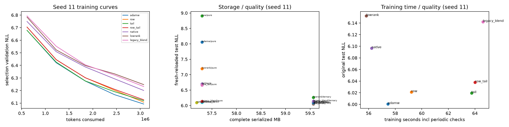

RPM-IHOG verification: measured scope and limits

Generated 20261030T163944Z; base commit `d50eec79832e6b3ec9ee943f45ac63d7e3f38b50`. The original repository files are preserved; every implementation/evidence addition is under this prefix.

Hardware/software

Verified requested Tesla V100-PCIE-32GB, UUID GPU-b1e26f14-9243-49b6-c5a7-51f7ce39672d, PCI 00000000:06:00.0, 32768 MiB inventory / _CudaDeviceProperties(name='Tesla V100-PCIE-32GB', major=7, minor=0, total_memory=32494MB, multi_processor_count=80, uuid=b1e26f14-9243-49b6-c5a7-51f7ce39672d, pci_bus_id=6, pci_device_id=0, pci_domain_id=0, L2_cache_size=6MB); compute capability 7.0. The RTX 4060 was excluded. PyTorch 2.14.1+cu126, CUDA runtime 12.6, Python 3.14.4 (main, Aug 20 2026, 10:41:58) [GCC 15.2.0]. CUDA compiler 12.4; sm_70 present; FP16 GEMM/backward finite. GCC 13 selected for CUDA compilation. Fresh task venv; existing runtime imported read-only; new dependencies installed locally.
[results/1793369020899782371_audit_3a7613/environment.json](../results/1793369020899782371_audit_3a7613/environment.json)

Pinned sources

WikiText-2 official splits: `b08601e04326c79dfdd32d625aee71d232d685c3`; GPT-2 tokenizer `607a30d783dfa663caf39e06633721c8d4cfcd7e`. Main token counts: train 2,428,601, validation 251,048, test 287,644. Content/token hashes and legacy corpus identity: [results/1793369017797097725_data_eb73ea/data.json](../results/1793369017797097725_data_eb73ea/data.json)
[results/1793369017797097725_data_eb73ea/model_identities.json](../results/1793369017797097725_data_eb73ea/model_identities.json)

Correctness

8 GPU/reference test groups passed, including rectangular factor forward/backward, FP64 gradcheck, block/full transforms, packing boundaries/CPU-GPU round trips, independent-process decode, causal masking, recurrence, QR zero/rank-deficient cases and no-clobber/resume rejection. Sixteen separately recorded CPU tests cover initialization, pinned data lineage, invalid codec payloads, retries and ignored/malformed/truncated/source-changed HTTP ranges. A zero-FP16-scale underflow was found and fixed before measurements. Raw evidence: [results/1793370616826531192_correctness_0c6313/checks.json](../results/1793370616826531192_correctness_0c6313/checks.json)

Legacy 300-step reproduction (one training seed)

Dense/native actual parameters: 9,609,728/1,778,176. FP16 autocast training, FP32 parameters and FP32 evaluation; hashed overlapping-byte-pair legacy task. AMP skips: 2/900. The latest serial reproduction is used; the earlier overlapping pilot timing is retained only as earlier evidence. No packed reload underlies this table.

| Arm | Original NLL | Pure refit NLL | Core+ternary NLL | Kronecker stable rank | training seconds |
|---|---:|---:|---:|---:|---:|
| 1_Standard_AdamW | 2.7448 | 8.7492 | 3.0993 | 64.95 | 7.42 |
| 2_EntropyConstrained_Kronecker_AdamW | 3.2818 | 3.2712 | 3.2760 | 7.03 | 7.71 |
| 3_Native_RPM_IHOG_Generator | 3.3066 | 3.3094 | 3.3070 | 5.41 | 6.53 |

The supplied native original/refit/residual NLLs reproduce to printed precision when the same corpus/source semantics are used. Pooling/QR randomness can differ after an explicitly separated RNG stream or software change; see deviations. Middle-layer-only stable rank is not a model-wide metric. Generic 256x256 rank-8 core is 1.125 theoretical bpw; ideal ternary totals 2.7725, while actual 2-bit ternary plus scale metadata is larger. Historical field names containing 0.53/2.12 are retained only as legacy labels.
[results/1793370878877666800_legacy_487b39/legacy_results.json](../results/1793370878877666800_legacy_487b39/legacy_results.json)

Main real-token training

The common recipe uses four width-256 layers, 16 top-2 experts, 128-token sequences, batch 16, GPT-2 vocabulary, FP32 parameters and FP16 autocast. Dense optimizer arms share initial weights and batch RNG; native/ordinary low-rank controls share non-expert tensors and match expert parameter counts. Dropout 0, clipping 1, Adam betas .9/.95, decay .05, LR .0003. Tail shrinkage is per successful update, delayed/ramped from step 300 to 600. Legacy post-step blending is labeled separately. Two LR choices per arm use only validation. Main seeds are 11/22/33; incomplete seed coverage is explicit. No tuning pilot sees test results.

| Arm | seeds | steps | Original test NLL | Pure reload ΔNLL | Ternary reload ΔNLL | Native direct ΔNLL | Train seconds incl periodic val/checkpoints | Peak allocated MiB |
|---|---:|---:|---:|---:|---:|---:|---:|---:|
| adamw | 3 | 1500,1500,1500 | 6.0085 | 3.5399 | 0.1000 | — | 56.78 | 1426.5 |
| row | 3 | 1500,1500,1500 | 6.0310 | 3.0854 | 0.0953 | — | 58.08 | 1394.1 |
| tail | 3 | 1500,1500,1500 | 6.0251 | 0.6772 | 0.0240 | — | 63.58 | 1427.0 |
| row_tail | 3 | 1500,1500,1500 | 6.0420 | 0.6327 | 0.0220 | — | 64.07 | 1395.3 |
| native | 3 | 1500,1500,1500 | 6.0977 | 0.0022 | 0.0005 | -0.0000 | 56.05 | 1353.6 |
| lowrank | 3 | 1500,1500,1500 | 6.1437 | 0.8404 | 0.0946 | — | 55.44 | 1353.5 |
| legacy_blend | 3 | 1500,1500,1500 | 6.1301 | -0.0038 | -0.0017 | — | 65.36 | 1427.9 |

Paired equal-token comparisons against dense AdamW, 95% Student-t intervals across seeds. Noninferiority margin +0.02 NLL; PPL ratio is exp(ΔNLL). These test only the declared recipe/tuning scope.

| Arm | paired seeds | ΔNLL mean | 95% CI | PPL ratio | equal-quality verdict |
|---|---:|---:|---|---:|---|
| row | 3 | 0.0225 | [-0.0007374936811376451, 0.04568788815524144] | 1.0227 | inconclusive |
| tail | 3 | 0.0166 | [0.011505791694047345, 0.021631592026555773] | 1.0167 | inconclusive |
| row_tail | 3 | 0.0334 | [0.014298142177764466, 0.05255847538973625] | 1.0340 | inconclusive |
| native | 3 | 0.0892 | [0.049129574895053735, 0.1292338709743283] | 1.0933 | contradicted_in_tested_scope |
| lowrank | 3 | 0.1351 | [0.09918100095383131, 0.17104500835451458] | 1.1447 | contradicted_in_tested_scope |
| legacy_blend | 3 | 0.1216 | [0.06951756045678745, 0.17366788445131565] | 1.1293 | contradicted_in_tested_scope |

Every individual run retains per-update counts, gradient norms, routing/utilization, activation RMS, checkpoint hashes, multi-layer/projection spectra, and exact packed reload metrics. Source directories: [results/1793370873212762834_train_510c39/training_results.json](../results/1793370873212762834_train_510c39/training_results.json), [results/1793370948567535613_train_e5a26f/training_results.json](../results/1793370948567535613_train_e5a26f/training_results.json), [results/1793371114319938563_train_a94d7a/training_results.json](../results/1793371114319938563_train_a94d7a/training_results.json), [results/1793371209673206740_train_79cc6a/training_results.json](../results/1793371209673206740_train_79cc6a/training_results.json), [results/1793371291314106526_train_a66e09/training_results.json](../results/1793371291314106526_train_a66e09/training_results.json), [results/1793371370423721380_train_b2a1e6/training_results.json](../results/1793371370423721380_train_b2a1e6/training_results.json), [results/1793371450743432772_train_c7135f/training_results.json](../results/1793371450743432772_train_c7135f/training_results.json), [results/1793371533084526906_train_4ae25c/training_results.json](../results/1793371533084526906_train_4ae25c/training_results.json), [results/1793372137824912469_train_8f1302/training_results.json](../results/1793372137824912469_train_8f1302/training_results.json), [results/1793372260910693237_train_ae9854/training_results.json](../results/1793372260910693237_train_ae9854/training_results.json), [results/1793372342009852540_train_46416a/training_results.json](../results/1793372342009852540_train_46416a/training_results.json), [results/1793372423695853623_train_70567e/training_results.json](../results/1793372423695853623_train_70567e/training_results.json), [results/1793372864353189640_train_8913f4/training_results.json](../results/1793372864353189640_train_8913f4/training_results.json), [results/1793373250513891972_train_53f552/training_results.json](../results/1793373250513891972_train_53f552/training_results.json), [results/1793375402812871815_train_ef703a/training_results.json](../results/1793375402812871815_train_ef703a/training_results.json), [results/1793375793976758821_train_abd3e2/training_results.json](../results/1793375793976758821_train_abd3e2/training_results.json), [results/1793375967006030090_train_0ce728/training_results.json](../results/1793375967006030090_train_0ce728/training_results.json), [results/1793376124575423225_train_17eaa3/training_results.json](../results/1793376124575423225_train_17eaa3/training_results.json), [results/1793376283172987651_train_277ab0/training_results.json](../results/1793376283172987651_train_277ab0/training_results.json), [results/1793376362352712796_train_f7d08e/training_results.json](../results/1793376362352712796_train_f7d08e/training_results.json), [results/1793376436630585768_train_8f8e0e/training_results.json](../results/1793376436630585768_train_8f8e0e/training_results.json)

Training archive accounting (means; complete archive includes unaffected parameters)

| Arm / export | Expert tensor bpw | Whole-model tensor bpw (dense equivalent) | Serialized bytes | Before NLL | Reload NLL | Execution |
|---|---:|---:|---:|---:|---:|---|
| adamw/pure | 1.1250 | 20.4408 | 57299117 | 6.0085 | 9.5484 | reference_decompressed / native materialized training path |
| adamw/ternary | 3.1882 | 21.2148 | 59565997 | 6.0085 | 6.1085 | reference_decompressed / native materialized training path |
| row/pure | 1.1250 | 20.4408 | 57299117 | 6.0310 | 9.1164 | reference_decompressed / native materialized training path |
| row/ternary | 3.1882 | 21.2148 | 59565997 | 6.0310 | 6.1264 | reference_decompressed / native materialized training path |
| tail/pure | 1.1250 | 20.4408 | 57299117 | 6.0251 | 6.7023 | reference_decompressed / native materialized training path |
| tail/ternary | 3.1882 | 21.2148 | 59565997 | 6.0251 | 6.0491 | reference_decompressed / native materialized training path |
| row_tail/pure | 1.1250 | 20.4408 | 57299117 | 6.0420 | 6.6747 | reference_decompressed / native materialized training path |
| row_tail/ternary | 3.1882 | 21.2148 | 59565997 | 6.0420 | 6.0639 | reference_decompressed / native materialized training path |
| native/native_direct | 1.0625 | 20.4173 | 57190381 | 6.0977 | 6.0977 | reference_decompressed / native materialized training path |
| native/pure | 1.1250 | 20.4408 | 57299117 | 6.0977 | 6.0999 | reference_decompressed / native materialized training path |
| native/ternary | 3.1882 | 21.2148 | 59565997 | 6.0977 | 6.0982 | reference_decompressed / native materialized training path |
| lowrank/pure | 1.1250 | 20.4408 | 57299117 | 6.1437 | 6.9841 | reference_decompressed / native materialized training path |
| lowrank/ternary | 3.1882 | 21.2148 | 59565997 | 6.1437 | 6.2383 | reference_decompressed / native materialized training path |
| legacy_blend/pure | 1.1250 | 20.4408 | 57299117 | 6.1301 | 6.1264 | reference_decompressed / native materialized training path |
| legacy_blend/ternary | 3.1882 | 21.2148 | 59565997 | 6.1301 | 6.1284 | reference_decompressed / native materialized training path |

Whole-model bpw uses represented dense-equivalent parameters, not the smaller trainable-factor count. Main shared tensors are FP32. Expert-only savings must not be relabeled whole-model savings. Baseline uncompressed and codec/reload memory include separate dense reconstruction and temporary workspaces; none demonstrates compressed complete-model GPU residency.

Training state and equal-wall-time observations

| arm | trainable parameters | expert parameters | optimizer tensor MiB | skipped AMP updates |
|---|---:|---:|---:|---|
| adamw | 22360832 | 8388608 | 170.60 | [0, 0, 0] |
| row | 22360832 | 8388608 | 138.72 | [0, 0, 0] |
| tail | 22360832 | 8388608 | 170.60 | [0, 0, 0] |
| row_tail | 22360832 | 8388608 | 138.72 | [0, 0, 0] |
| native | 14529280 | 557056 | 110.85 | [0, 0, 0] |
| lowrank | 14529280 | 557056 | 110.85 | [0, 0, 0] |
| legacy_blend | 22360832 | 8388608 | 170.60 | [0, 0, 0] |

Descriptive equal-wall-time comparison uses the minimum completed training clock across seven arms within each seed; the last observed held-out validation checkpoint at/before that cutoff is reported without interpolation. Checkpoint staleness is explicit and these64-block selection metrics do not replace final test endpoints: `{"11": {"common_seconds": 55.82409391700003, "arms": {"adamw": {"step": 1200, "observed_seconds": 45.7506006120002, "tokens": 2457600, "selection_validation_nll": 6.167016983032227, "staleness_seconds": 10.073493304999829}, "row": {"step": 1200, "observed_seconds": 47.194648888999836, "tokens": 2457600, "selection_validation_nll": 6.202045254409313, "staleness_seconds": 8.629445028000191}, "tail": {"step": 1200, "observed_seconds": 50.50926220299971, "tokens": 2457600, "selection_validation_nll": 6.190729655325413, "staleness_seconds": 5.31483171400032}, "row_tail": {"step": 1200, "observed_seconds": 50.70082729600017, "tokens": 2457600, "selection_validation_nll": 6.209541492164135, "staleness_seconds": 5.123266620999857}, "native": {"step": 1200, "observed_seconds": 44.81428394699924, "tokens": 2457600, "selection_validation_nll": 6.2932159304618835, "staleness_seconds": 11.009809970000788}, "lowrank": {"step": 1500, "observed_seconds": 55.512900178000564, "tokens": 3072000, "selection_validation_nll": 6.247046418488026, "staleness_seconds": 0.3111937389994637}, "legacy_blend": {"step": 1200, "observed_seconds": 51.397282980000455, "tokens": 2457600, "selection_validation_nll": 6.322603464126587, "staleness_seconds": 4.426810936999573}}}, "22": {"common_seconds": 54.6114265970009, "arms": {"adamw": {"step": 1200, "observed_seconds": 44.74348068600011, "tokens": 2457600, "selection_validation_nll": 6.177815794944763, "staleness_seconds": 9.867945911000788}, "row": {"step": 1200, "observed_seconds": 46.14754605500002, "tokens": 2457600, "selection_validation_nll": 6.207092866301537, "staleness_seconds": 8.46388054200088}, "tail": {"step": 1200, "observed_seconds": 50.22967285699997, "tokens": 2457600, "selection_validation_nll": 6.193063676357269, "staleness_seconds": 4.381753740000931}, "row_tail": {"step": 1200, "observed_seconds": 50.7093516369996, "tokens": 2457600, "selection_validation_nll": 6.220871403813362, "staleness_seconds": 3.9020749600013005}, "native": {"step": 1200, "observed_seconds": 44.66165612400073, "tokens": 2457600, "selection_validation_nll": 6.24151536822319, "staleness_seconds": 9.949770473000171}, "lowrank": {"step": 1500, "observed_seconds": 54.302554277001036, "tokens": 3072000, "selection_validation_nll": 6.223268650472164, "staleness_seconds": 0.308872319999864}, "legacy_blend": {"step": 1200, "observed_seconds": 53.43499173900091, "tokens": 2457600, "selection_validation_nll": 6.30296166986227, "staleness_seconds": 1.1764348579999933}}}, "33": {"common_seconds": 55.88605373000064, "arms": {"adamw": {"step": 1200, "observed_seconds": 45.19952624899997, "tokens": 2457600, "selection_validation_nll": 6.170492574572563, "staleness_seconds": 10.686527481000667}, "row": {"step": 1200, "observed_seconds": 45.48780135999914, "tokens": 2457600, "selection_validation_nll": 6.195372574031353, "staleness_seconds": 10.3982523700015}, "tail": {"step": 1200, "observed_seconds": 50.31098847800058, "tokens": 2457600, "selection_validation_nll": 6.188471496105194, "staleness_seconds": 5.5750652520000585}, "row_tail": {"step": 1200, "observed_seconds": 50.778940158001205, "tokens": 2457600, "selection_validation_nll": 6.223132312297821, "staleness_seconds": 5.1071135719994345}, "native": {"step": 1500, "observed_seconds": 55.604266954000195, "tokens": 3072000, "selection_validation_nll": 6.176315329968929, "staleness_seconds": 0.28178677600044466}, "lowrank": {"step": 1500, "observed_seconds": 55.538621409999905, "tokens": 3072000, "selection_validation_nll": 6.208436973392963, "staleness_seconds": 0.34743232000073476}, "legacy_blend": {"step": 1200, "observed_seconds": 51.20916256499913, "tokens": 2457600, "selection_validation_nll": 6.290631972253323, "staleness_seconds": 4.676891165001507}}}}`.

Tuning, initialization and time budgets

Validation-only LR selection: `{"adamw": {"selected_lr": 0.0003, "selection_validation_nll": 6.357734817318136, "source": "results/1793369368898195504_train_4c1590", "tuning_runs": 2}, "legacy_blend": {"selected_lr": 0.0003, "selection_validation_nll": 6.480220571213508, "source": "results/1793370553965600821_train_b811db", "tuning_runs": 2}, "lowrank": {"selected_lr": 0.0003, "selection_validation_nll": 6.455472660210593, "source": "results/1793369764034908703_train_01b269", "tuning_runs": 2}, "native": {"selected_lr": 0.0003, "selection_validation_nll": 6.433610258632506, "source": "results/1793369711606231971_train_b23fd5", "tuning_runs": 2}, "row": {"selected_lr": 0.0003, "selection_validation_nll": 6.371341054868722, "source": "results/1793369424200546946_train_165cf6", "tuning_runs": 2}, "row_tail": {"selected_lr": 0.0003, "selection_validation_nll": 6.374963925724915, "source": "results/1793369539155073804_train_f11513", "tuning_runs": 2}, "tail": {"selected_lr": 0.0003, "selection_validation_nll": 6.360989633109848, "source": "results/1793369480414480621_train_5b8ded", "tuning_runs": 2}}`. The common-recipe main table is untuned; when the selected LR equals .0003 it also supplies that chosen-recipe endpoint. Other selected settings need their own main replications. Rank 4/8 and zero/weaker/ramped tail pilots are secondary coverage, not a combinatorial search. Function-matched dense arms start from native-materialized expert weights and retain the native initialization distribution; they are separate from ordinary dense initialization.

Validation-only bounded rank/penalty pilots

| arm | rank | tail strength per update | LR | complete validation NLL | consumed tokens | measured train seconds |
|---|---:|---:|---:|---:|---:|---:|
| adamw | 8 | 0.003 | 0.0003 | 6.35773 | 1228800 | 23.50 |
| row | 8 | 0.003 | 0.0003 | 6.37134 | 1228800 | 23.61 |
| tail | 8 | 0.003 | 0.0003 | 6.36099 | 1228800 | 25.32 |
| row_tail | 8 | 0.003 | 0.0003 | 6.37496 | 1228800 | 25.20 |
| native | 8 | 0.003 | 0.0003 | 6.43361 | 1228800 | 22.37 |
| lowrank | 8 | 0.003 | 0.0003 | 6.45547 | 1228800 | 22.18 |
| adamw | 8 | 0.003 | 0.0003 | 10.37100 | 10240 | 1.05 |
| adamw | 8 | 0.003 | 0.0003 | 9.94114 | 20480 | 1.90 |
| legacy_blend | 8 | 0.003 | 0.0003 | 6.48022 | 1228800 | 26.19 |
| adamw | 8 | 0.003 | 0.0003 | 9.94114 | 20480 | 1.22 |
| native | 4 | 0.003 | 0.0003 | 6.43431 | 1228800 | 23.12 |
| lowrank | 4 | 0.003 | 0.0003 | 6.50043 | 1228800 | 21.94 |
| tail | 8 | 0.0 | 0.0003 | 6.35773 | 1228800 | 23.40 |
| tail | 8 | 0.0003 | 0.0003 | 6.35783 | 1228800 | 24.65 |
| row_tail | 8 | 0.0 | 0.0003 | 6.37134 | 1228800 | 23.27 |
| row_tail | 8 | 0.0003 | 0.0003 | 6.37119 | 1228800 | 25.13 |

Each pilot is seed11 only at600 updates; none is a replicated final-quality claim. Rank variation and tail0/.0003/.003 are not combined into a grid. Pure ordinary low rank has the same factor scalar count as the native control; archive tables separately evaluate each learned representation.

Function-matched paired test NLL differences: `{"adamw_minus_native": {"mean": -0.08906927849379542, "n": 1, "ci95": null}}`.

Time to the predeclared common validation NLL 7.0 (checkpoints every 300 steps; no extrapolation): `{"adamw": {"target_nll": 7.0, "measured_times_seconds": [11.126613446000192, 10.928778845000124, 10.935041541999453], "status": "reached"}, "row": {"target_nll": 7.0, "measured_times_seconds": [11.332751244000065, 11.237039286999789, 10.993177104999631], "status": "reached"}, "tail": {"target_nll": 7.0, "measured_times_seconds": [11.021911009999712, 10.933113379000133, 10.971062013000846], "status": "reached"}, "row_tail": {"target_nll": 7.0, "measured_times_seconds": [11.132925662000162, 11.044171055999868, 11.067562680000265], "status": "reached"}, "native": {"target_nll": 7.0, "measured_times_seconds": [10.922683666999546, 10.889228577000722, 11.032865399000002], "status": "reached"}, "lowrank": {"target_nll": 7.0, "measured_times_seconds": [10.765840740000385, 10.639080005001233, 10.772731176000889], "status": "reached"}, "legacy_blend": {"target_nll": 7.0, "measured_times_seconds": [12.69886835699981, 13.082450579000579, 12.531757156999447], "status": "reached"}}`. Equal-wall-time curves use measured selection validation endpoints; do not interpret periodic minibatch training loss as held-out quality.

Controlled optimizer mechanism

| zero-init arm | summed gradient null norm | summed update null norm | final null weight norm | fitted loss |
|---|---:|---:|---:|---:|
| sgd | 3.57116e-16 | 1.14814e-15 | 1.16534e-16 | 0.00192231 |
| adamw | 3.72302e-17 | 11.6442 | 2.01721 | 6.71981e-06 |
| row | 8.12164e-17 | 4.74054e-06 | 1.20157e-06 | 2.40135e-05 |
| tail | 3.62943e-17 | 11.9826 | 2.25585 | 6.33292e-06 |
| isotropic | 3.61637e-17 | 11.7005 | 1.30438 | 5.28715e-06 |

Five seeds, known 16-dimensional row space in R64, zero and matched random initializations, fixed geometry and deterministic batch noise=0. Coordinatewise preconditioning moves actual updates outside the gradient row space; row pooling strongly reduces that effect in this fixture. This does not establish that AdamW maximizes entropy, that null-space motion causes language-model compression losses, or that nonlinear low-sensitivity modes are exact null directions. Histogram/body clipping, raw scales and permutation/factor-shape sensitivity are recorded. Isotropic decay is fixed-strength rather than norm matched; noisy geometry sweeps remain open.
[results/1793369304154885202_mechanism_b1979c/mechanism.json](../results/1793369304154885202_mechanism_b1979c/mechanism.json)

Bitrate and matched-byte matrix controls

| codec | tensor bpw | serialized bpw | SQNR dB | matched-byte ordinary LR rank | LR SQNR dB |
|---|---:|---:|---:|---:|---:|
| pure | 0.6094 | 0.6450 | 0.293 | 13 | 0.839 |
| ternary | 2.6251 | 2.6702 | 7.507 | 56 | 2.338 |
| int2 | 2.6251 | 2.6702 | 9.604 | 56 | 2.338 |
| int2_sign | 3.6407 | 3.6925 | 14.102 | 77 | 2.990 |
| int4 | 4.2500 | 4.2789 | 18.386 | 90 | 3.390 |

Complete real gate matrix scope; this table is not full-model quality. Native direct synthetic fixture FP16 payload is 1.0625 bpw before framing; generic core 1.125 at 256x256. 2-bit residual plus sign is three residual bits per entry. File/container metadata and unaffected model tensors are counted separately. INT8 factors, FP8 compute, and ideal base-3 storage are not asserted.
[results/1793369816128440199_bitrate_9b7ee8/bitrate.json](../results/1793369816128440199_bitrate_9b7ee8/bitrate.json)

Real pretrained full-model fidelity

| model / codec | Baseline NLL | Reload NLL | ΔNLL / PPL ratio | Δ block 95% CI | Expert/MLP bpw | Whole bpw | Serialized bytes | Resident execution |
|---|---:|---:|---|---|---:|---:|---:|---|
| ibm-granite/granite-3.1-1b-a400m-base/int2_sign | 2.2219 | 2.4613 | +0.2393 / 1.2704 | [0.23391798259130678, 0.24508036731078445] | 3.6512 | 6.3417 | 1063770711 | reference_decompressed |
| ibm-granite/granite-3.1-1b-a400m-base/int4 | 2.2219 | 2.2899 | +0.0680 / 1.0703 | [0.06557822307385282, 0.07052995455968436] | 4.2500 | 6.8837 | 1149825970 | reference_decompressed |

ibm-granite/granite-3.1-1b-a400m-base immutable revision `408b6e90baab8cf24f4aa9f8e19703ffa0a53b29`; full actual model/tokenizer, 128 train-only calibration sequences length 128; codec selected on first-layer validation pilot, then entire target tensor set encoded and reloaded in a fresh process. Coverage, original/source hashes and full parameter shapes are recorded. Original weights are never loaded by the packed decoder. Calibration is independent; Granite gate/up uses real routed inputs, down is unweighted. Block-bootstrap CI treats contiguous contexts as units; the final short block is token-weighted in NLL. This is an engineering codec pilot with explicitly pending matched-byte full-model low-rank, second-domain coverage. Later fitting and full downstream results are reported separately below.
[results/1793369759921020449_pretrained_5f19ee/pretrained_results.json](../results/1793369759921020449_pretrained_5f19ee/pretrained_results.json)

| HuggingFaceTB/SmolLM2-1.7B/int2_sign | 2.3678 | 6.3452 | +3.9775 / 53.3821 | [3.928208867025475, 4.031668022183584] | 3.5234 | 7.1935 | 1539168734 | reference_decompressed |
| HuggingFaceTB/SmolLM2-1.7B/int4 | 2.3678 | 2.4564 | +0.0887 / 1.0927 | [0.0865247034095246, 0.09074990865212852] | 4.2500 | 7.7064 | 1648772025 | reference_decompressed |

HuggingFaceTB/SmolLM2-1.7B immutable revision `effd688a12921b4cc83e3312b6feb579f70f9c71`; full actual model/tokenizer, 128 train-only calibration sequences length 128; codec selected on first-layer validation pilot, then entire target tensor set encoded and reloaded in a fresh process. Coverage, original/source hashes and full parameter shapes are recorded. Original weights are never loaded by the packed decoder. Calibration is independent; Granite gate/up uses real routed inputs, down is unweighted. Block-bootstrap CI treats contiguous contexts as units; the final short block is token-weighted in NLL. This is an engineering codec pilot with explicitly pending matched-byte full-model low-rank, second-domain coverage. Later fitting and full downstream results are reported separately below.
[results/1793369763093764329_pretrained_fe6d9c/pretrained_results.json](../results/1793369763093764329_pretrained_fe6d9c/pretrained_results.json)

Measured direct execution

sm_70 CUDA packed residual compiled in 0.05 s. Kernel decodes packed weights on chip; readable FP32 factor contractions and block FWHT vectors avoid global dense residual allocation. Resident FP32 factor copies are counted. Same saved payloads as the fidelity archive; CUDA events and host time, random interleaved groups, equal warmup and profiler traces retained. Sustained copy diagnostic: 811.63 GB/s counting reads+writes. Integer decode, FP32 FMA, FP16 conversion, transforms, intermediates and launches preclude assigning the tensor-core peak as the relevant compute ceiling.

| model/codec | matrix | batch | dense FP16 median ms | direct complete median ms | speed ratio | resident direct bytes | peak temporary bytes |
|---|---|---:|---:|---:|---:|---:|---:|
| ibm-granite/granite-3.1-1b-a400m-base/int2_sign | [512, 1024] | 1 | 0.00893 | 0.07803 | 0.1145 | 275464 | 141312 |
| ibm-granite/granite-3.1-1b-a400m-base/int2_sign | [512, 1024] | 4 | 0.01250 | 0.10438 | 0.1198 | 275464 | 368640 |
| ibm-granite/granite-3.1-1b-a400m-base/int2_sign | [512, 1024] | 16 | 0.01291 | 0.10763 | 0.1199 | 275464 | 1277952 |
| ibm-granite/granite-3.1-1b-a400m-base/int2_sign | [512, 1024] | 128 | 0.01341 | 0.51179 | 0.0262 | 275464 | 9764864 |
| ibm-granite/granite-3.1-1b-a400m-base/int4 | [512, 1024] | 1 | 0.01102 | 0.01608 | 0.6853 | 278528 | 2048 |
| ibm-granite/granite-3.1-1b-a400m-base/int4 | [512, 1024] | 4 | 0.01180 | 0.02301 | 0.5127 | 278528 | 8192 |
| ibm-granite/granite-3.1-1b-a400m-base/int4 | [512, 1024] | 16 | 0.01174 | 0.06813 | 0.1723 | 278528 | 32768 |
| ibm-granite/granite-3.1-1b-a400m-base/int4 | [512, 1024] | 128 | 0.01269 | 0.48956 | 0.0259 | 278528 | 262144 |
| HuggingFaceTB/SmolLM2-1.7B/int2_sign | [8192, 2048] | 1 | 0.04988 | 0.15562 | 0.3206 | 8450056 | 2277376 |
| HuggingFaceTB/SmolLM2-1.7B/int2_sign | [8192, 2048] | 4 | 0.06418 | 0.45976 | 0.1396 | 8450056 | 2818048 |
| HuggingFaceTB/SmolLM2-1.7B/int2_sign | [8192, 2048] | 16 | 0.06651 | 1.65296 | 0.0402 | 8450056 | 4980736 |
| HuggingFaceTB/SmolLM2-1.7B/int2_sign | [8192, 2048] | 128 | 0.10017 | 12.79548 | 0.0078 | 8450056 | 25165824 |
| HuggingFaceTB/SmolLM2-1.7B/int4 | [8192, 2048] | 1 | 0.04870 | 0.12143 | 0.4011 | 8912896 | 32768 |
| HuggingFaceTB/SmolLM2-1.7B/int4 | [8192, 2048] | 4 | 0.07365 | 0.45147 | 0.1631 | 8912896 | 131072 |
| HuggingFaceTB/SmolLM2-1.7B/int4 | [8192, 2048] | 16 | 0.06733 | 1.77008 | 0.0380 | 8912896 | 524288 |
| HuggingFaceTB/SmolLM2-1.7B/int4 | [8192, 2048] | 128 | 0.10459 | 14.07752 | 0.0074 | 8912896 | 4194304 |

Complete routed/gated bank measurements (router, top-k weights, SiLU(gate)*up, down, scatter included; no attention or full-model decode):

| codec | batch | expert union | dense median ms | direct median ms | speed ratio |
|---|---:|---:|---:|---:|---:|
| int2_sign | 1 | 8 | 2.84592 | 5.27463 | 0.5395 |
| int2_sign | 4 | 24 | 3.84890 | 11.26058 | 0.3418 |
| int2_sign | 16 | 32 | 4.21844 | 14.18140 | 0.2975 |
| int2_sign | 128 | 32 | 4.04910 | 19.94630 | 0.2030 |
| int4 | 1 | 8 | 2.83719 | 2.82106 | 1.0057 |
| int4 | 4 | 20 | 3.49322 | 3.50272 | 0.9973 |
| int4 | 16 | 32 | 4.17408 | 4.58832 | 0.9097 |
| int4 | 128 | 32 | 4.11222 | 15.32820 | 0.2683 |

CPU pure-core components, one fixed thread, same core as materialized comparator: `[{"model": "ibm-granite/granite-3.1-1b-a400m-base", "codec": "int2_sign", "speed_ratio": 0.8829765709988424}, {"model": "HuggingFaceTB/SmolLM2-1.7B", "codec": "int2_sign", "speed_ratio": 1.463818233686464}]`. These omit residual/rotation and do not carry full-model fidelity. GPU/CPU matrix or bank timings cannot establish complete-model generation throughput, prefill/TTFT, KV residency, or distributed performance. Cache-resident weight reuse is measured; streaming working-set coverage remains not_run; separate complete-model autoregressive measurements follow below.
[results/1793376475849530707_runtime_326021/runtime.json](../results/1793376475849530707_runtime_326021/runtime.json)

Streaming/archive verification

| fixture tensors | source bytes | downloaded bytes | peak live source bytes | total archive bytes | coverage/reload |
|---|---:|---:|---:|---:|---|
| 2 | 262552 | 262552 | 262144 | 53947 | True / fresh process |
| 17 | 4195912 | 4195912 | 262144 | 812359 | True / fresh process |
| 65 | 16782712 | 16782712 | 262144 | 3239324 | True / fresh process |

Real remote complete expert-matrix samples: 6; downloaded 9463488 bytes. Exact HTTP206/ranges/revisions, expert IDs/depths/projections, payload/source hashes and SQNR are recorded. No full large model archive or residency claim follows from samples.
[results/1793371020953143857_streaming_7da6a8/streaming.json](../results/1793371020953143857_streaming_7da6a8/streaming.json)

Distributed applicability

| representation | whole FP32 gradient bytes | expert FP32 gradient bytes | Adam moments bytes |
|---|---:|---:|---:|
| adamw | 89443328 | 33554432 | 178886656 |
| native | 58117120 | 2228224 | 116234240 |
| lowrank | 58117120 | 2228224 | 116234240 |

Unequal sequential shards [2,1] match concatenated gradients and an optimizer update with stochastic effects disabled. Real trained dense gradients—not just learned weights—feed ordinary/shared-Kronecker coefficient projections and INT8/error-feedback diagnostics. Coefficients are numeric; independently fitted Kronecker factors cannot be averaged separately. The current shared-basis pilot uses an initial centralized SVD, explicitly not a proven distributed basis-refresh method; the future launcher counts full refresh traffic. Whole-model parameter payload dominates any expert-only ratio. DDP does not synchronize Adam optimizer states. Ring sensitivity estimates use actual full gradient bytes plus link bandwidth/hop latency, with no claim of measured allreduce or time-to-quality.
[results/1793370614115522989_distributed_22a182/distributed.json](../results/1793370614115522989_distributed_22a182/distributed.json)
Actual multi-GPU training is blocked: only one GPU is authorized. multigpu_launcher.py is provided for distinct authorized devices; no duplicate-device NCCL ranks or RTX 4060 runs occurred.

Full real-activation sequential fitting

Granite complete-model NLL: untouched 2.221945, independent one-shot 2.461294, sequential closed-loop plus functional fitting 2.350255. Remaining delta +0.128310; PPL ratio 1.1369; paired token-weighted block CI [0.12428025067768285, 0.13242413268781977]. Actual expert bpw 3.6512, whole-model tensor bpw 6.3417, serialized bytes including partial manifests 1,064,184,988. Execution for these quality numbers is reference_decompressed.

| layer | held-out gated-bank R² before | after FP16 factor/scale export | fit seconds incl calibration |
|---|---:|---:|---:|
| 0 | 0.953104 | 0.982489 | 4.31 |
| 1 | 0.941969 | 0.964467 | 4.98 |
| 2 | 0.923545 | 0.949047 | 6.05 |
| 3 | 0.918777 | 0.944861 | 6.98 |
| 4 | 0.929130 | 0.961638 | 7.89 |
| 5 | 0.962340 | 0.999938 | 8.85 |
| 6 | 0.894699 | 0.985779 | 9.88 |
| 7 | 0.940942 | 0.989814 | 10.85 |
| 8 | 0.895310 | 0.919911 | 11.82 |
| 9 | 0.901003 | 0.923602 | 12.77 |
| 10 | 0.901134 | 0.925120 | 13.72 |
| 11 | 0.901401 | 0.923886 | 14.76 |
| 12 | 0.910193 | 0.942308 | 15.72 |
| 13 | 0.899659 | 0.928467 | 16.62 |
| 14 | 0.903592 | 0.933635 | 17.58 |
| 15 | 0.900725 | 0.933741 | 18.69 |
| 16 | 0.911730 | 0.944118 | 19.54 |
| 17 | 0.910657 | 0.938477 | 20.45 |
| 18 | 0.903729 | 0.936118 | 21.48 |
| 19 | 0.907621 | 0.931159 | 22.46 |
| 20 | 0.908086 | 0.929304 | 23.51 |
| 21 | 0.897165 | 0.920899 | 24.57 |
| 22 | 0.884642 | 0.973392 | 25.51 |
| 23 | 0.516251 | 0.997900 | 26.46 |

Every current bank sees actual compressed-prefix train inputs. Teacher targets use the original complete routed SiLU(gate)*up/down bank on those same inputs. Only factors, row/column multipliers and scalar residual gains train; gains fold into existing scale fields and fixed codes never consult targets at decode. Eighty updates/layer, LR .003, seed17 plus layer stride1009; full archive reloaded in a fresh process. Independent one-shot versus closed-loop+fitting changes two interventions, so it does not isolate closed-loop causation. Last-layer high R² must not be substituted for whole-model NLL or all-layer fidelity.
[results/1793371508260674874_distillation_519e84/distillation_results.json](../results/1793371508260674874_distillation_519e84/distillation_results.json)

Real calibration-component controls

| depth | variant | held-out bank R² | status |
|---|---|---:|---|
| 0 | activation_balance_rotation | 0.9526992216808964 | completed |
| 0 | no_activation_weighting | 0.949560850881327 | completed |
| 0 | no_balancing | — | unsupported_numerical_configuration |
| 0 | no_rotation | 0.9446832451728242 | completed |
| 12 | activation_balance_rotation | 0.9097920031219279 | completed |
| 12 | no_activation_weighting | 0.9048906874076509 | completed |
| 12 | no_balancing | 0.8653143746922197 | completed |
| 12 | no_rotation | 0.7308479929870922 | completed |
| 23 | activation_balance_rotation | 0.4971054790709495 | completed |
| 23 | no_activation_weighting | 0.45779944711461584 | completed |
| 23 | no_balancing | 0.9442177069454635 | completed |
| 23 | no_rotation | 0.6678712941014207 | completed |

Complete banks at first/middle/last depth use routed train input RMS, including true nonlinear down inputs. Three one-component removals compare with activation+balancing+rotation at fixed rank/code format. Effects vary by depth; this is not evidence of a universally favorable balancing/rotation choice. The first-layer no-balancing case overflows FP16 inverse activation scales and is explicitly unsupported numerically, rather than receiving a fabricated R². The original failed trial is preserved; a new validator rejects nonfinite fields, bad shapes and reserved codes. A stabilized/FP32-scale variant needs its own bytes/quality experiment.
[results/1793372361616414378_calibration-ablation_3f961c/calibration_ablation.json](../results/1793372361616414378_calibration-ablation_3f961c/calibration_ablation.json)

Verified large-source samples

| source | source tensor | complete matrix | fetched bytes | tensor bpw | weight SQNR dB | GPU peak MiB |
|---|---|---|---:|---:|---:|---:|
| Qwen/Qwen3.8-27B | model.language_model.layers.4.mlp.gate_proj.weight | [17408, 5120] | 178257920 | 3.5107 | 13.952 | 5220.8 |
| Qwen/Qwen3.8-27B | model.language_model.layers.28.mlp.up_proj.weight | [17408, 5120] | 178257920 | 3.5107 | 13.941 | 5220.8 |
| Qwen/Qwen3.8-27B | model.language_model.layers.52.mlp.down_proj.weight | [5120, 17408] | 178257920 | 3.5063 | 13.936 | 5220.8 |
| Qwen/Qwen3.8-Flash-Next | model.language_model.layers.0.mlp.experts.gate_up_proj | [1280, 2560] | 6553600 | 3.5413 | 13.987 | 201.1 |
| Qwen/Qwen3.8-Flash-Next | model.language_model.layers.24.mlp.experts.gate_up_proj | [1280, 2560] | 6553600 | 3.5413 | 13.986 | 201.1 |
| Qwen/Qwen3.8-Flash-Next | model.language_model.layers.47.mlp.experts.down_proj | [2560, 640] | 3276800 | 3.6013 | 14.013 | 105.9 |

Actual downloaded bytes including checked headers: 551,188,736. Sources retain their exact requested names and audited revisions; current architecture configs are inspected rather than assumed historical names/shapes. HTTP ranges cover complete dense projections or complete experts, never unmarked crops. These samples do not establish full large-model archive coverage, language quality or27GB residency.
[results/1793371644106045825_large-streaming_634166/large_streaming.json](../results/1793371644106045825_large-streaming_634166/large_streaming.json)

Full downstream task accuracy

| model | representation | task | full questions | accuracy | normalized accuracy |
|---|---|---|---:|---:|---:|
| ibm-granite/granite-3.1-1b-a400m-base | original | piqa | 1838 | 0.74918 | 0.75299 |
| ibm-granite/granite-3.1-1b-a400m-base | original | arc_easy | 2376 | 0.70244 | 0.67466 |
| ibm-granite/granite-3.1-1b-a400m-base | int4 | piqa | 1838 | 0.74266 | 0.74374 |
| ibm-granite/granite-3.1-1b-a400m-base | int4 | arc_easy | 2376 | 0.68308 | 0.65741 |
| ibm-granite/granite-3.1-1b-a400m-base | int2_sign | piqa | 1838 | 0.71817 | 0.73177 |
| ibm-granite/granite-3.1-1b-a400m-base | int2_sign | arc_easy | 2376 | 0.64394 | 0.62710 |
| ibm-granite/granite-3.1-1b-a400m-base | distilled | piqa | 1838 | 0.71872 | 0.73177 |
| ibm-granite/granite-3.1-1b-a400m-base | distilled | arc_easy | 2376 | 0.64815 | 0.62584 |
| HuggingFaceTB/SmolLM2-1.7B | original | piqa | 1838 | 0.77203 | 0.77639 |
| HuggingFaceTB/SmolLM2-1.7B | original | arc_easy | 2376 | 0.77862 | 0.73527 |
| HuggingFaceTB/SmolLM2-1.7B | int4 | piqa | 1838 | 0.75734 | 0.77040 |
| HuggingFaceTB/SmolLM2-1.7B | int4 | arc_easy | 2376 | 0.76473 | 0.72854 |
| HuggingFaceTB/SmolLM2-1.7B | int2_sign | piqa | 1838 | 0.55930 | 0.55223 |
| HuggingFaceTB/SmolLM2-1.7B | int2_sign | arc_easy | 2376 | 0.36616 | 0.36237 |

Paired normalized-accuracy deltas and question-bootstrap95%CIs: `[{"model": "ibm-granite/granite-3.1-1b-a400m-base", "codec": "int4", "task": "piqa", "normalized_accuracy_delta": -0.009249183895538629, "ci95": [-0.019042437431991296, 0.001088139281828074], "questions": 1838, "unit": "question/document"}, {"model": "ibm-granite/granite-3.1-1b-a400m-base", "codec": "int4", "task": "arc_easy", "normalized_accuracy_delta": -0.017255892255892257, "ci95": [-0.0281986531986532, -0.006734006734006734], "questions": 2376, "unit": "question/document"}, {"model": "ibm-granite/granite-3.1-1b-a400m-base", "codec": "int2_sign", "task": "piqa", "normalized_accuracy_delta": -0.021218715995647442, "ci95": [-0.03536452665941241, -0.007616974972796518], "questions": 1838, "unit": "question/document"}, {"model": "ibm-granite/granite-3.1-1b-a400m-base", "codec": "int2_sign", "task": "arc_easy", "normalized_accuracy_delta": -0.04755892255892256, "ci95": [-0.06272095959595961, -0.03156565656565657], "questions": 2376, "unit": "question/document"}, {"model": "ibm-granite/granite-3.1-1b-a400m-base", "codec": "distilled", "task": "piqa", "normalized_accuracy_delta": -0.021218715995647442, "ci95": [-0.03427638737758433, -0.008705114254624592], "questions": 1838, "unit": "question/document"}, {"model": "ibm-granite/granite-3.1-1b-a400m-base", "codec": "distilled", "task": "arc_easy", "normalized_accuracy_delta": -0.04882154882154882, "ci95": [-0.06313131313131314, -0.034511784511784514], "questions": 2376, "unit": "question/document"}, {"model": "HuggingFaceTB/SmolLM2-1.7B", "codec": "int4", "task": "piqa", "normalized_accuracy_delta": -0.005984766050054407, "ci95": [-0.01632208922742111, 0.003808487486398259], "questions": 1838, "unit": "question/document"}, {"model": "HuggingFaceTB/SmolLM2-1.7B", "codec": "int4", "task": "arc_easy", "normalized_accuracy_delta": -0.006734006734006734, "ci95": [-0.016835016835016835, 0.003367003367003367], "questions": 2376, "unit": "question/document"}, {"model": "HuggingFaceTB/SmolLM2-1.7B", "codec": "int2_sign", "task": "piqa", "normalized_accuracy_delta": -0.22415669205658323, "ci95": [-0.2486398258977149, -0.1969532100108814], "questions": 1838, "unit": "question/document"}, {"model": "HuggingFaceTB/SmolLM2-1.7B", "codec": "int2_sign", "task": "arc_easy", "normalized_accuracy_delta": -0.3728956228956229, "ci95": [-0.3952020202020202, -0.35058922558922556], "questions": 2376, "unit": "question/document"}]`. Full1838 PIQA validation and2376 ARC-Easy test examples, zero-shot canonical harness definitions, context limit512, no chat template. Model/tokenizer and dataset revisions/content hashes are pinned. Numeric per-question scores/correctness and document hashes are published; text bodies are omitted. These are task accuracies, not teacher token agreement. Smoke-limit4 results are excluded from this table. Sources: [results/1793372365132606450_downstream_fcb689/downstream_results.json](../results/1793372365132606450_downstream_fcb689/downstream_results.json), [results/1793372786460469486_downstream_a5d3fb/downstream_results.json](../results/1793372786460469486_downstream_a5d3fb/downstream_results.json), [results/1793373178761603423_downstream_410f68/downstream_results.json](../results/1793373178761603423_downstream_410f68/downstream_results.json), [results/1793375317394641110_downstream_f905e4/downstream_results.json](../results/1793375317394641110_downstream_f905e4/downstream_results.json), [results/1793375720500354414_downstream_94a857/downstream_results.json](../results/1793375720500354414_downstream_94a857/downstream_results.json), [results/1793375893275426300_downstream_d23d5d/downstream_results.json](../results/1793375893275426300_downstream_d23d5d/downstream_results.json), [results/1793376044641814458_downstream_9e1d5e/downstream_results.json](../results/1793376044641814458_downstream_9e1d5e/downstream_results.json)

Complete actual packed model execution

The same complete distilled Granite artifact `9612b59e5b8de9c77ae0bf6306dbb32dfb5aea517c790114d44981bc2e6888d6` runs all24 banks directly. Its expert matrices are absent from the direct model; factor contractions, packed residual CUDA decode, transforms, gating/routing, attention, shared tensors, head, KV cache and launch overhead all execute. Direct-vs-decompressed complete test NLL delta: +0.00000099, CI [-1.240972490009858e-06, 3.5633067440120204e-06]; declared matching tolerance .001. This is separate from the codec's original-model +.01 fidelity test.

| execution | exact resident storage MiB | allocated before inputs MiB | load peak MiB | inference peak MiB | host peak MiB |
|---|---:|---:|---:|---:|---:|
| reference_decompressed (dense) | 5091.2 | 5099.3 | 5355.3 | 5355.3 | 6191.9 |
| direct (fused_FWHT_v2) | 1090.0 | 1091.1 | 1091.1 | 1391.6 | 6196.1 |

| execution | context | teacher forced | prefill median ms | host TTFT median s | decode median tokens/s | end-to-end median s |
|---|---:|---|---:|---:|---:|---:|
| reference_decompressed | 32 | False | 142.329 | 0.14236 | 20.823 | 0.86253 |
| reference_decompressed | 32 | True | 142.470 | 0.14250 | 20.781 | 0.86410 |
| reference_decompressed | 128 | False | 161.832 | 0.16186 | 20.574 | 0.89095 |
| reference_decompressed | 128 | True | 161.807 | 0.16183 | 20.507 | 0.89347 |
| direct | 32 | False | 299.265 | 0.29929 | 8.558 | 2.05193 |
| direct | 32 | True | 300.427 | 0.30045 | 8.527 | 2.05951 |
| direct | 128 | False | 483.361 | 0.48339 | 8.517 | 2.24441 |
| direct | 128 | True | 483.872 | 0.48390 | 8.502 | 2.24822 |

Twenty timing groups per condition,16 tokens, equal warmup, one fixed validation prompt with contexts32/128. Greedy and identical-token teacher-forced workloads are separate. Host logging/return values add no per-token sync; readable routing still includes nonzero synchronization in both methods. Fresh process order is fixed rather than interleaved; moderate performance differences would need stronger controls. Shared Granite FP32 precision is required because the untouched FP16 eager path was nonfinite. No fair vendor-optimized INT4 complete-model comparator is asserted. Direct-model logical storage counts FP32 factor copies and all unmodified/shared weights; allocation/reservation/load peaks are separate. A complete decoder CPU/CUDA trace is retained locally with published hash and summary. No source expert matrix or per-call CPU weight transfer is used.
[results/1793376481249984697_full-runtime_9f4c36/full_runtime_results.json](../results/1793376481249984697_full-runtime_9f4c36/full_runtime_results.json)

Preservation and software audit

All eight base tracked files and relevant original local inputs are hash-checked; staged diff scans are supplied separately. Strict containment of the initial ensurepip transient bootstrap is not established because venv creation preceded TMPDIR export. Later setup/run paths redirect caches/temp files into the task root. See PRESERVATION_AUDIT.md. NumPy active-version metadata correction/restoration is in configs/008; Torch training/RNG math stayed unchanged and final statistics use2.5.4. Actual future worker imports are recorded in worker_identity.json. This qualification does not replace the original-file integrity results.

Claim ledger

| Claim | verdict | bounded interpretation |
|---|---|---|
| A | inconclusive | See paired main-training table: compressibility and equal-quality are reported separately; common recipe, bounded tuning, and plateau/continuation coverage limit generalization |
| B | inconclusive | The limited preconditioning/null-update mechanism is observed; the stronger universal entropy/useless-null-space causal explanation is not established |
| C | contradicted_in_tested_scope | One-shot plus bounded full Granite functional fitting were tested. Fitting improves NLL, but acceptance concerns the same-model +.01 tolerance; this is not a universal verdict on stronger PTQ recipes |
| D | contradicted_in_tested_scope | Measured payload/framing and complete archive totals differ from historical bitrate labels; native/generic/ternary/sign budgets are explicitly distinguished |
| E | contradicted_in_tested_scope | Actual complete direct-packed Granite forward/generation and same-payload reference measured; see quality, resident storage, latency and fixed-process-order limit jointly |
| F | supported_in_tested_scope | Complete fixture archives have full manifest coverage, bounded per-tensor source ranges, interruption/resume, raw fallback and fresh-process restoration; remote real matrices remain samples |
| G | blocked | Actual multi-GPU time-to-quality requires additional authorized devices; single-GPU algebra and bandwidth projections do not satisfy it |
| H13 | inconclusive | Legacy diagnostics reproduce improved Kronecker compressibility with worse uncompressed NLL; exact historical 13x configuration differs and one middle bank is not a multi-layer equal-quality result |
| H05 | contradicted_in_tested_scope | At the supplied 256x256 rank-8 shapes, generic/native factors alone exceed 0.5 bpw before framing; no 0.5-bpw no-loss result was reproduced |
| H998 | inconclusive | Some individual fitted banks approach/exceed99.8% R²; the all-layer values vary and complete-model NLL still changes. Historical full-cascade fidelity is not established |
| HCPU | inconclusive | CPU component ratios measured at actual shapes; no full-path 5x–10x claim or historical-workload identity established |
| H83 | inconclusive | No8.3x complete-model speed claim supported by this actual saved payload/implementation; different historical synthetic cascades are not equivalent workloads |
| H27 | not_run | Large-model identities/configs verified, but full archive/coverage/load/residency and full execution were not produced |

Smallest useful contribution

A reproducible distinction between training-induced compressibility, optimizer geometry, actual archive bytes, direct compressed operator cost, and full-model language quality. Exact native-factor export is independently testable and avoids conflating a later SVD refit with native representability. Positive fixture/mechanism/storage results remain useful even when equal-quality or speed claims are inconclusive/negative.

Remaining evidence

Read all per-stage errors and incomplete coverage. Needed for stronger claims: selected/tuned and plateau-complete training replications where absent; noisy/norm-matched causal controls; more rank/factor-shape/permutation controls; full-model matched-byte alternatives, richer closed-loop/distillation/calibration and downstream domains/tasks; optimized transform/core fusion, fair decode/prefill and streaming working sets; complete large archive/restoration/residency; actual multi-GPU time to common quality. Blocked/not_run stages are not scientific failures.

Reproduction and recovery

Exact per-stage commands and source identities are in results/*/config.json and process.json. Invoke `bash run.sh --stage STAGE`; use a new immutable result directory for each retry. See README_VERIFICATION.md, latest progress file and RESUME_PROMPT*.md. All model/data/checkpoint artifact paths are local-only, with content hashes; never publish their bodies. Final integrity/publication evidence is added separately after staging.

