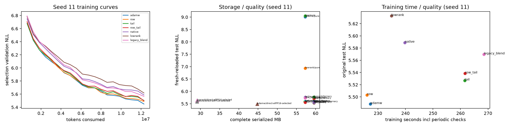

RPM-IHOG verification: measured scope and limits

Generated 20261030T190704Z; base commit `d50eec79832e6b3ec9ee943f45ac63d7e3f38b50`. The original repository files are preserved; every implementation/evidence addition is under this prefix.

Hardware/software

Verified requested Tesla V100-PCIE-32GB, UUID GPU-b1e26f14-9243-49b6-c5a7-51f7ce39672d, PCI 00000000:06:00.0, 32768 MiB inventory / _CudaDeviceProperties(name='Tesla V100-PCIE-32GB', major=7, minor=0, total_memory=32494MB, multi_processor_count=80, uuid=b1e26f14-9243-49b6-c5a7-51f7ce39672d, pci_bus_id=6, pci_device_id=0, pci_domain_id=0, L2_cache_size=6MB); compute capability 7.0. The RTX 4060 was excluded. PyTorch 2.14.1+cu126, CUDA runtime 12.6, Python 3.14.4 (main, Aug 20 2026, 10:41:58) [GCC 15.2.0]. Driver 580.178.04; CUDA compiler 12.4; CPU Intel Core i7-13700H (20 logical CPUs), host RAM32,520,777,728 bytes. sm_70 present; FP16 GEMM/backward finite. GCC 13 selected for CUDA compilation. Fresh task venv; existing runtime imported read-only; new dependencies installed locally.
[results/1793369020899782371_audit_3a7613/environment.json](../results/1793369020899782371_audit_3a7613/environment.json)

Pinned sources

WikiText-2 official splits: `b08601e04326c79dfdd32d625aee71d232d685c3`; GPT-2 tokenizer `607a30d783dfa663caf39e06633721c8d4cfcd7e`. Main token counts: train 2,428,601, validation 251,048, test 287,644. Content/token hashes and legacy corpus identity: [results/1793369017797097725_data_eb73ea/data.json](../results/1793369017797097725_data_eb73ea/data.json)
[results/1793369017797097725_data_eb73ea/model_identities.json](../results/1793369017797097725_data_eb73ea/model_identities.json)

Correctness

8 GPU/reference test groups passed, including rectangular factor forward/backward, FP64 gradcheck, block/full transforms, packing boundaries/CPU-GPU round trips, independent-process decode, causal masking, recurrence, QR zero/rank-deficient cases and no-clobber/resume rejection. Sixteen separately recorded CPU tests cover initialization, pinned data lineage, invalid codec payloads, retries and ignored/malformed/truncated/source-changed HTTP ranges. A zero-FP16-scale underflow was found and fixed before measurements. Raw evidence: [results/1793370616826531192_correctness_0c6313/checks.json](../results/1793370616826531192_correctness_0c6313/checks.json)

Legacy 300-step reproduction (one training seed)

Dense/native actual parameters: 9,609,728/1,778,176. FP16 autocast training, FP32 parameters and FP32 evaluation; hashed overlapping-byte-pair legacy task. AMP skips: 2/900. The latest serial reproduction is used; the earlier overlapping pilot timing is retained only as earlier evidence. No packed reload underlies this table.

| Arm | Original NLL | Pure refit NLL | Core+ternary NLL | Kronecker stable rank | training seconds |
|---|---:|---:|---:|---:|---:|
| 1_Standard_AdamW | 2.7448 | 8.7492 | 3.0993 | 64.95 | 7.42 |
| 2_EntropyConstrained_Kronecker_AdamW | 3.2818 | 3.2712 | 3.2760 | 7.03 | 7.71 |
| 3_Native_RPM_IHOG_Generator | 3.3066 | 3.3094 | 3.3070 | 5.41 | 6.53 |

The supplied native original/refit/residual NLLs reproduce to printed precision when the same corpus/source semantics are used. The row+QR arm differs under the tested stack; its discrepancy cause was not isolated. Main experiments separately isolate RNG streams. See exact printed-value comparisons and implementation deviations. Middle-layer-only stable rank is not a model-wide metric. Generic 256x256 rank-8 core is 1.125 theoretical bpw; ideal ternary totals 2.7725, while actual 2-bit ternary plus scale metadata is larger. Historical field names containing 0.53/2.12 are retained only as legacy labels.
[results/1793370878877666800_legacy_487b39/legacy_results.json](../results/1793370878877666800_legacy_487b39/legacy_results.json)

Legacy printed-value verification

| arm | matching non-time printed metrics | original NLL difference from supplied | pure-refit NLL difference | ternary NLL difference |
|---|---:|---:|---:|---:|
| 1_Standard_AdamW | 12/12 | +0.0000 | +0.0000 | +0.0000 |
| 2_EntropyConstrained_Kronecker_AdamW | 1/12 | +0.0018 | -0.0026 | +0.0002 |
| 3_Native_RPM_IHOG_Generator | 12/12 | +0.0000 | +0.0000 | +0.0000 |

This compares the twelve non-time values supplied in the mission at their printed precision, not hidden unrounded originals. Training timing is hardware/software dependent and is measured separately above. The claimed row+QR results are revised rather than silently called exact reproduction. Native dense-to-Kronecker stable-rank ratio in this one bank is64.95/5.41≈12.0, with the original-model NLL tradeoff shown above. Full per-metric deltas are in this report’s JSON.

Main real-token training

The common recipe uses four width-256 layers, 16 top-2 experts, 128-token sequences, batch 16, GPT-2 vocabulary, FP32 parameters and FP16 autocast. Dense optimizer arms share initial weights and batch RNG; native/ordinary low-rank controls share non-expert tensors and match expert parameter counts. Dropout 0, clipping 1, Adam betas .9/.95, decay .05, LR .0003. Tail shrinkage is per successful update, delayed/ramped from step 300 to 600. Legacy post-step blending is labeled separately. Two LR choices per arm use only validation. Main seeds are 11/22/33; incomplete seed coverage is explicit. No tuning pilot sees test results.

| Arm | seeds | steps | Original test NLL | Pure reload ΔNLL | Ternary reload ΔNLL | Native direct ΔNLL | Train seconds incl periodic val/checkpoints | Peak allocated MiB |
|---|---:|---:|---:|---:|---:|---:|---:|---:|
| adamw | 5 | 6000,6000,6000,6000,6000 | 5.4967 | 4.2824 | 0.2228 | — | 228.96 | 1476.8 |
| row | 5 | 6000,6000,6000,6000,6000 | 5.5050 | 3.7796 | 0.1934 | — | 227.68 | 1445.6 |
| tail | 3 | 6000,6000,6000 | 5.5353 | 0.2111 | 0.0014 | — | 262.28 | 1511.3 |
| row_tail | 3 | 6000,6000,6000 | 5.5449 | 0.2331 | 0.0119 | — | 260.50 | 1480.9 |
| native | 3 | 6000,6000,6000 | 5.5918 | 0.0059 | 0.0004 | 0.0000 | 234.15 | 1410.7 |
| lowrank | 3 | 6000,6000,6000 | 5.6449 | 1.2508 | 0.1433 | — | 231.61 | 1409.6 |
| legacy_blend | 3 | 6000,6000,6000 | 5.5823 | -0.0163 | -0.0043 | — | 267.64 | 1511.9 |

Paired equal-token comparisons against dense AdamW, 95% Student-t intervals across seeds. Noninferiority margin +0.02 NLL; PPL ratio is exp(ΔNLL). These test only the declared recipe/tuning scope.

| Arm | paired seeds | ΔNLL mean | 95% CI | PPL ratio | equal-quality verdict |
|---|---:|---:|---|---:|---|
| row | 5 | 0.0083 | [-0.001225251230239208, 0.01783918768632583] | 1.0083 | supported_in_tested_scope |
| tail | 3 | 0.0363 | [0.031218881351277077, 0.041439890898713055] | 1.0370 | contradicted_in_tested_scope |
| row_tail | 3 | 0.0460 | [0.0319151128407862, 0.060075668509512944] | 1.0471 | contradicted_in_tested_scope |
| native | 3 | 0.0928 | [0.07342589573901143, 0.11225215192160945] | 1.0973 | contradicted_in_tested_scope |
| lowrank | 3 | 0.1460 | [0.12861095633830966, 0.1633106068462652] | 1.1572 | contradicted_in_tested_scope |
| legacy_blend | 3 | 0.0833 | [0.06066151923837125, 0.10595831517203218] | 1.0869 | contradicted_in_tested_scope |

Every individual run retains per-update counts, gradient norms, routing/utilization, activation RMS, checkpoint hashes, multi-layer/projection spectra, and exact packed reload metrics. Source directories: [results/1793379518674050373_train_9777dd/training_results.json](../results/1793379518674050373_train_9777dd/training_results.json), [results/1793379706313697319_train_87887b/training_results.json](../results/1793379706313697319_train_87887b/training_results.json), [results/1793379890977817036_train_1bd3d2/training_results.json](../results/1793379890977817036_train_1bd3d2/training_results.json), [results/1793380106975909798_train_05f5e7/training_results.json](../results/1793380106975909798_train_05f5e7/training_results.json), [results/1793380323214633758_train_524d4d/training_results.json](../results/1793380323214633758_train_524d4d/training_results.json), [results/1793380530607602925_train_45c938/training_results.json](../results/1793380530607602925_train_45c938/training_results.json), [results/1793380728980142234_train_818e92/training_results.json](../results/1793380728980142234_train_818e92/training_results.json), [results/1793380951934609726_train_3d76f2/training_results.json](../results/1793380951934609726_train_3d76f2/training_results.json), [results/1793381153752628915_train_7c6f35/training_results.json](../results/1793381153752628915_train_7c6f35/training_results.json), [results/1793381343062363512_train_f941fb/training_results.json](../results/1793381343062363512_train_f941fb/training_results.json), [results/1793381561845530087_train_c3c390/training_results.json](../results/1793381561845530087_train_c3c390/training_results.json), [results/1793381775909269375_train_4ea8b7/training_results.json](../results/1793381775909269375_train_4ea8b7/training_results.json), [results/1793381974060417625_train_643d9e/training_results.json](../results/1793381974060417625_train_643d9e/training_results.json), [results/1793382167400368896_train_6bf8b8/training_results.json](../results/1793382167400368896_train_6bf8b8/training_results.json), [results/1793382384987191480_train_f32726/training_results.json](../results/1793382384987191480_train_f32726/training_results.json), [results/1793382573878086265_train_0c4249/training_results.json](../results/1793382573878086265_train_0c4249/training_results.json), [results/1793382763394816386_train_bf1755/training_results.json](../results/1793382763394816386_train_bf1755/training_results.json), [results/1793382979194802153_train_4dbb6f/training_results.json](../results/1793382979194802153_train_4dbb6f/training_results.json), [results/1793383192699014029_train_ba24c5/training_results.json](../results/1793383192699014029_train_ba24c5/training_results.json), [results/1793383391621178562_train_a5a220/training_results.json](../results/1793383391621178562_train_a5a220/training_results.json), [results/1793383584531803466_train_baecbb/training_results.json](../results/1793383584531803466_train_baecbb/training_results.json), [results/1793385238680127061_train_052b78/training_results.json](../results/1793385238680127061_train_052b78/training_results.json), [results/1793385495067564523_train_ac7b01/training_results.json](../results/1793385495067564523_train_ac7b01/training_results.json), [results/1793385750436422685_train_d51db8/training_results.json](../results/1793385750436422685_train_d51db8/training_results.json), [results/1793385997775194711_train_1d2884/training_results.json](../results/1793385997775194711_train_1d2884/training_results.json)

Training archive accounting (means; complete archive includes unaffected parameters)

| Arm / export | Expert tensor bpw | Whole-model tensor bpw (dense equivalent) | Serialized bytes | Before NLL | Reload NLL | Execution |
|---|---:|---:|---:|---:|---:|---|
| adamw/pure | 1.1250 | 20.4408 | 57299117 | 5.4967 | 9.7791 | reference_decompressed / native materialized training path |
| adamw/ternary | 3.1882 | 21.2148 | 59565997 | 5.4967 | 5.7196 | reference_decompressed / native materialized training path |
| row/pure | 1.1250 | 20.4408 | 57299117 | 5.5050 | 9.2847 | reference_decompressed / native materialized training path |
| row/ternary | 3.1882 | 21.2148 | 59565997 | 5.5050 | 5.6985 | reference_decompressed / native materialized training path |
| tail/pure | 1.1250 | 20.4408 | 57299117 | 5.5353 | 5.7464 | reference_decompressed / native materialized training path |
| tail/ternary | 3.1882 | 21.2148 | 59565997 | 5.5353 | 5.5367 | reference_decompressed / native materialized training path |
| row_tail/pure | 1.1250 | 20.4408 | 57299117 | 5.5449 | 5.7781 | reference_decompressed / native materialized training path |
| row_tail/ternary | 3.1882 | 21.2148 | 59565997 | 5.5449 | 5.5568 | reference_decompressed / native materialized training path |
| native/native_direct | 1.0625 | 20.4173 | 57190381 | 5.5918 | 5.5918 | reference_decompressed / native materialized training path |
| native/pure | 1.1250 | 20.4408 | 57299117 | 5.5918 | 5.5977 | reference_decompressed / native materialized training path |
| native/ternary | 3.1882 | 21.2148 | 59565997 | 5.5918 | 5.5922 | reference_decompressed / native materialized training path |
| lowrank/pure | 1.1250 | 20.4408 | 57299117 | 5.6449 | 6.8957 | reference_decompressed / native materialized training path |
| lowrank/ternary | 3.1882 | 21.2148 | 59565997 | 5.6449 | 5.7882 | reference_decompressed / native materialized training path |
| legacy_blend/pure | 1.1250 | 20.4408 | 57299117 | 5.5823 | 5.5660 | reference_decompressed / native materialized training path |
| legacy_blend/ternary | 3.1882 | 21.2148 | 59565997 | 5.5823 | 5.5780 | reference_decompressed / native materialized training path |

Whole-model bpw uses represented dense-equivalent parameters, not the smaller trainable-factor count. Main shared tensors are FP32. Expert-only savings must not be relabeled whole-model savings. Baseline uncompressed and codec/reload memory include separate dense reconstruction and temporary workspaces; none demonstrates compressed complete-model GPU residency.

Training state and equal-wall-time observations

| arm | trainable parameters | expert parameters | optimizer tensor MiB | skipped AMP updates |
|---|---:|---:|---:|---|
| adamw | 22360832 | 8388608 | 170.60 | [0, 0, 0, 0, 0] |
| row | 22360832 | 8388608 | 138.72 | [0, 0, 0, 0, 0] |
| tail | 22360832 | 8388608 | 170.60 | [0, 0, 0] |
| row_tail | 22360832 | 8388608 | 138.72 | [0, 0, 0] |
| native | 14529280 | 557056 | 110.85 | [0, 0, 1] |
| lowrank | 14529280 | 557056 | 110.85 | [0, 0, 0] |
| legacy_blend | 22360832 | 8388608 | 170.60 | [0, 0, 0] |

Descriptive equal-wall-time comparison uses the minimum completed training clock across seven arms within each seed; the last observed held-out validation checkpoint at/before that cutoff is reported without interpolation. Checkpoint staleness is explicit and these64-block selection metrics do not replace final test endpoints: `{"11": {"common_seconds": 226.02618467300272, "arms": {"adamw": {"step": 5700, "observed_seconds": 215.60600607099877, "tokens": 11673600, "selection_validation_nll": 5.5051206313073635, "staleness_seconds": 10.420178602003944}, "row": {"step": 6000, "observed_seconds": 225.64134169099998, "tokens": 12288000, "selection_validation_nll": 5.4881036058068275, "staleness_seconds": 0.3848429820027377}, "tail": {"step": 5100, "observed_seconds": 221.45251999599895, "tokens": 10444800, "selection_validation_nll": 5.566375099122524, "staleness_seconds": 4.573664677003762}, "row_tail": {"step": 5100, "observed_seconds": 221.45801871899857, "tokens": 10444800, "selection_validation_nll": 5.563284404575825, "staleness_seconds": 4.568165954004144}, "native": {"step": 5400, "observed_seconds": 215.3826670999988, "tokens": 11059200, "selection_validation_nll": 5.6631819270551205, "staleness_seconds": 10.643517573003919}, "lowrank": {"step": 5700, "observed_seconds": 222.54783098400185, "tokens": 11673600, "selection_validation_nll": 5.67780638858676, "staleness_seconds": 3.478353689000869}, "legacy_blend": {"step": 4800, "observed_seconds": 213.94803133299865, "tokens": 9830400, "selection_validation_nll": 5.676822438836098, "staleness_seconds": 12.078153340004064}}}, "22": {"common_seconds": 228.7342340920004, "arms": {"adamw": {"step": 5700, "observed_seconds": 226.90815333699902, "tokens": 11673600, "selection_validation_nll": 5.471026998013258, "staleness_seconds": 1.8260807550013851}, "row": {"step": 6000, "observed_seconds": 228.3441536620012, "tokens": 12288000, "selection_validation_nll": 5.455762952566147, "staleness_seconds": 0.390080429999216}, "tail": {"step": 5100, "observed_seconds": 223.81449653899836, "tokens": 10444800, "selection_validation_nll": 5.529259912669659, "staleness_seconds": 4.919737553002051}, "row_tail": {"step": 5100, "observed_seconds": 220.70305180599826, "tokens": 10444800, "selection_validation_nll": 5.532565239816904, "staleness_seconds": 8.03118228600215}, "native": {"step": 5700, "observed_seconds": 219.09623540400207, "tokens": 11673600, "selection_validation_nll": 5.57929852232337, "staleness_seconds": 9.637998687998333}, "lowrank": {"step": 5700, "observed_seconds": 217.75482780400125, "tokens": 11673600, "selection_validation_nll": 5.6489951610565186, "staleness_seconds": 10.979406287999154}, "legacy_blend": {"step": 5100, "observed_seconds": 226.27852473899839, "tokens": 10444800, "selection_validation_nll": 5.626931611448526, "staleness_seconds": 2.455709353002021}}}, "33": {"common_seconds": 227.73639930699937, "arms": {"adamw": {"step": 6000, "observed_seconds": 227.30535615799818, "tokens": 12288000, "selection_validation_nll": 5.444442108273506, "staleness_seconds": 0.4310431490011979}, "row": {"step": 5700, "observed_seconds": 216.9591526309996, "tokens": 11673600, "selection_validation_nll": 5.408583801239729, "staleness_seconds": 10.777246675999777}, "tail": {"step": 5100, "observed_seconds": 221.39403420500093, "tokens": 10444800, "selection_validation_nll": 5.540369343012571, "staleness_seconds": 6.342365101998439}, "row_tail": {"step": 5100, "observed_seconds": 220.3026720380003, "tokens": 10444800, "selection_validation_nll": 5.560075186192989, "staleness_seconds": 7.433727268999064}, "native": {"step": 5700, "observed_seconds": 219.59210401299788, "tokens": 11673600, "selection_validation_nll": 5.5680965557694435, "staleness_seconds": 8.144295294001495}, "lowrank": {"step": 5700, "observed_seconds": 218.4415663050022, "tokens": 11673600, "selection_validation_nll": 5.625504873692989, "staleness_seconds": 9.294833001997176}, "legacy_blend": {"step": 5100, "observed_seconds": 226.63952144500217, "tokens": 10444800, "selection_validation_nll": 5.625237945467234, "staleness_seconds": 1.0968778619972}}}}`.

Tuning, initialization and time budgets

Validation-only LR selection: `{"adamw": {"selected_lr": 0.0003, "selection_validation_nll": 6.357734817318136, "source": "results/1793369368898195504_train_4c1590", "tuning_runs": 2}, "legacy_blend": {"selected_lr": 0.0003, "selection_validation_nll": 6.480220571213508, "source": "results/1793370553965600821_train_b811db", "tuning_runs": 2}, "lowrank": {"selected_lr": 0.0003, "selection_validation_nll": 6.455472660210593, "source": "results/1793369764034908703_train_01b269", "tuning_runs": 2}, "native": {"selected_lr": 0.0003, "selection_validation_nll": 6.433610258632506, "source": "results/1793369711606231971_train_b23fd5", "tuning_runs": 2}, "row": {"selected_lr": 0.0003, "selection_validation_nll": 6.371341054868722, "source": "results/1793369424200546946_train_165cf6", "tuning_runs": 2}, "row_tail": {"selected_lr": 0.0003, "selection_validation_nll": 6.374963925724915, "source": "results/1793369539155073804_train_f11513", "tuning_runs": 2}, "tail": {"selected_lr": 0.0003, "selection_validation_nll": 6.360989633109848, "source": "results/1793369480414480621_train_5b8ded", "tuning_runs": 2}}`. The common-recipe main table is untuned; when the selected LR equals .0003 it also supplies that chosen-recipe endpoint. Other selected settings need their own main replications. Rank 4/8 and zero/weaker/ramped tail pilots are secondary coverage, not a combinatorial search. Function-matched dense arms start from native-materialized expert weights and retain the native initialization distribution; they are separate from ordinary dense initialization. Matching copies FP32-materialized expert values exactly; native factor materialization and dense matrix casting have different AMP operation orders, so bitwise identical mixed-precision forwards are not asserted.

Validation-only bounded rank/penalty pilots

| arm | rank | tail strength per update | LR | complete validation NLL | consumed tokens | measured train seconds |
|---|---:|---:|---:|---:|---:|---:|
| adamw | 8 | 0.003 | 0.0003 | 6.35773 | 1228800 | 23.50 |
| row | 8 | 0.003 | 0.0003 | 6.37134 | 1228800 | 23.61 |
| tail | 8 | 0.003 | 0.0003 | 6.36099 | 1228800 | 25.32 |
| row_tail | 8 | 0.003 | 0.0003 | 6.37496 | 1228800 | 25.20 |
| native | 8 | 0.003 | 0.0003 | 6.43361 | 1228800 | 22.37 |
| lowrank | 8 | 0.003 | 0.0003 | 6.45547 | 1228800 | 22.18 |
| adamw | 8 | 0.003 | 0.0003 | 10.37100 | 10240 | 1.05 |
| adamw | 8 | 0.003 | 0.0003 | 9.94114 | 20480 | 1.90 |
| legacy_blend | 8 | 0.003 | 0.0003 | 6.48022 | 1228800 | 26.19 |
| adamw | 8 | 0.003 | 0.0003 | 9.94114 | 20480 | 1.22 |
| native | 4 | 0.003 | 0.0003 | 6.43431 | 1228800 | 23.12 |
| lowrank | 4 | 0.003 | 0.0003 | 6.50043 | 1228800 | 21.94 |
| tail | 8 | 0.0 | 0.0003 | 6.35773 | 1228800 | 23.40 |
| tail | 8 | 0.0003 | 0.0003 | 6.35783 | 1228800 | 24.65 |
| row_tail | 8 | 0.0 | 0.0003 | 6.37134 | 1228800 | 23.27 |
| row_tail | 8 | 0.0003 | 0.0003 | 6.37119 | 1228800 | 25.13 |

Each pilot is seed11 only at600 updates; none is a replicated final-quality claim. Rank variation and tail0/.0003/.003 are not combined into a grid. Pure ordinary low rank has the same factor scalar count as the native control; archive tables separately evaluate each learned representation.

Function-matched paired test NLL differences: `{"adamw_minus_native": {"mean": -0.0948428316827948, "n": 3, "ci95": [-0.1277605497372625, -0.06192511362832708]}, "row_tail_minus_native": {"mean": 0.001768240393171953, "n": 3, "ci95": [-0.0041715930964621945, 0.007708073882806101]}}`.

Time to the predeclared common validation NLL 7.0 (checkpoints every 300 steps; no extrapolation): `{"adamw": {"target_nll": 7.0, "measured_times_seconds": [11.126613446000192, 10.928778845000124, 10.935041541999453, 11.254318461000366, 10.914214446002006], "status": "reached"}, "row": {"target_nll": 7.0, "measured_times_seconds": [11.332751244000065, 11.237039286999789, 10.993177104999631, 11.66195577399776, 11.165363674001128], "status": "reached"}, "tail": {"target_nll": 7.0, "measured_times_seconds": [11.021911009999712, 10.933113379000133, 10.971062013000846], "status": "reached"}, "row_tail": {"target_nll": 7.0, "measured_times_seconds": [11.132925662000162, 11.044171055999868, 11.067562680000265], "status": "reached"}, "native": {"target_nll": 7.0, "measured_times_seconds": [10.922683666999546, 10.889228577000722, 11.032865399000002], "status": "reached"}, "lowrank": {"target_nll": 7.0, "measured_times_seconds": [10.765840740000385, 10.639080005001233, 10.772731176000889], "status": "reached"}, "legacy_blend": {"target_nll": 7.0, "measured_times_seconds": [12.69886835699981, 13.082450579000579, 12.531757156999447], "status": "reached"}}`. Equal-wall-time curves use measured selection validation endpoints; do not interpret periodic minibatch training loss as held-out quality.

Controlled optimizer mechanism

| zero-init arm | summed gradient null norm | summed update null norm | final null weight norm | fitted loss |
|---|---:|---:|---:|---:|
| sgd | 3.57116e-16 | 1.14814e-15 | 1.16534e-16 | 0.00192231 |
| adamw | 3.72302e-17 | 11.6442 | 2.01721 | 6.71981e-06 |
| row | 8.12164e-17 | 4.74054e-06 | 1.20157e-06 | 2.40135e-05 |
| tail | 3.62943e-17 | 11.9826 | 2.25585 | 6.33292e-06 |
| isotropic | 3.61637e-17 | 11.7005 | 1.30438 | 5.28715e-06 |

Five seeds, known 16-dimensional row space in R64, zero and matched random initializations, fixed geometry and deterministic batch noise=0. Coordinatewise preconditioning moves actual updates outside the gradient row space; row pooling strongly reduces that effect in this fixture. This does not establish that AdamW maximizes entropy, that null-space motion causes language-model compression losses, or that nonlinear low-sensitivity modes are exact null directions. Histogram/body clipping, raw scales and permutation/factor-shape sensitivity are recorded. Isotropic decay is fixed-strength rather than norm matched; noisy geometry sweeps remain open.
[results/1793369304154885202_mechanism_b1979c/mechanism.json](../results/1793369304154885202_mechanism_b1979c/mechanism.json)

Bitrate and matched-byte matrix controls

| codec | tensor bpw | serialized bpw | SQNR dB | matched-byte ordinary LR rank | LR SQNR dB |
|---|---:|---:|---:|---:|---:|
| pure | 0.6094 | 0.6450 | 0.293 | 13 | 0.839 |
| ternary | 2.6251 | 2.6702 | 7.507 | 56 | 2.338 |
| int2 | 2.6251 | 2.6702 | 9.604 | 56 | 2.338 |
| int2_sign | 3.6407 | 3.6925 | 14.102 | 77 | 2.990 |
| int4 | 4.2500 | 4.2789 | 18.386 | 90 | 3.390 |

Complete real gate matrix scope; this table is not full-model quality. Native direct synthetic fixture FP16 payload is 1.0625 bpw before framing; generic core 1.125 at 256x256. 2-bit residual plus sign is three residual bits per entry. File/container metadata and unaffected model tensors are counted separately. INT8 factors, FP8 compute, and ideal base-3 storage are not asserted.
[results/1793369816128440199_bitrate_9b7ee8/bitrate.json](../results/1793369816128440199_bitrate_9b7ee8/bitrate.json)

Real pretrained full-model fidelity

| model / codec | Baseline NLL | Reload NLL | ΔNLL / PPL ratio | Δ block 95% CI | Expert/MLP bpw | Whole bpw | Serialized bytes | Resident execution |
|---|---:|---:|---|---|---:|---:|---:|---|
| ibm-granite/granite-3.1-1b-a400m-base/int2_sign | 2.2219 | 2.4613 | +0.2393 / 1.2704 | [0.23391798259130678, 0.24508036731078445] | 3.6512 | 6.3417 | 1063770711 | reference_decompressed |
| ibm-granite/granite-3.1-1b-a400m-base/int4 | 2.2219 | 2.2899 | +0.0680 / 1.0703 | [0.06557822307385282, 0.07052995455968436] | 4.2500 | 6.8837 | 1149825970 | reference_decompressed |

ibm-granite/granite-3.1-1b-a400m-base immutable revision `408b6e90baab8cf24f4aa9f8e19703ffa0a53b29`; full actual model/tokenizer, 128 train-only calibration sequences length 128; codec selected on first-layer validation pilot, then entire target tensor set encoded and reloaded in a fresh process. Coverage, original/source hashes and full parameter shapes are recorded. Original weights are never loaded by the packed decoder. Calibration is independent; Granite gate/up uses real routed inputs, down is unweighted. Block-bootstrap CI treats contiguous contexts as units; the final short block is token-weighted in NLL. This is an engineering codec pilot with explicitly pending matched-byte full-model low-rank, second-domain coverage. Later fitting and full downstream results are reported separately below.
[results/1793369759921020449_pretrained_5f19ee/pretrained_results.json](../results/1793369759921020449_pretrained_5f19ee/pretrained_results.json)

| HuggingFaceTB/SmolLM2-1.7B/int2_sign | 2.3678 | 6.3452 | +3.9775 / 53.3821 | [3.928208867025475, 4.031668022183584] | 3.5234 | 7.1935 | 1539168734 | reference_decompressed |
| HuggingFaceTB/SmolLM2-1.7B/int4 | 2.3678 | 2.4564 | +0.0887 / 1.0927 | [0.0865247034095246, 0.09074990865212852] | 4.2500 | 7.7064 | 1648772025 | reference_decompressed |

HuggingFaceTB/SmolLM2-1.7B immutable revision `effd688a12921b4cc83e3312b6feb579f70f9c71`; full actual model/tokenizer, 128 train-only calibration sequences length 128; codec selected on first-layer validation pilot, then entire target tensor set encoded and reloaded in a fresh process. Coverage, original/source hashes and full parameter shapes are recorded. Original weights are never loaded by the packed decoder. Calibration is independent; Granite gate/up uses real routed inputs, down is unweighted. Block-bootstrap CI treats contiguous contexts as units; the final short block is token-weighted in NLL. This is an engineering codec pilot with explicitly pending matched-byte full-model low-rank, second-domain coverage. Later fitting and full downstream results are reported separately below.
[results/1793369763093764329_pretrained_fe6d9c/pretrained_results.json](../results/1793369763093764329_pretrained_fe6d9c/pretrained_results.json)

Measured direct execution

sm_70 CUDA packed residual compiled in 0.05 s. Kernel decodes packed weights on chip; readable FP32 factor contractions and block FWHT vectors avoid global dense residual allocation. Resident FP32 factor copies are counted. Same saved payloads as the fidelity archive; CUDA events and host time, random interleaved groups, equal warmup and profiler traces retained. Sustained copy diagnostic: 811.63 GB/s counting reads+writes. Integer decode, FP32 FMA, FP16 conversion, transforms, intermediates and launches preclude assigning the tensor-core peak as the relevant compute ceiling.

| model/codec | matrix | batch | dense FP16 median ms | direct complete median ms | speed ratio | resident direct bytes | peak temporary bytes |
|---|---|---:|---:|---:|---:|---:|---:|
| ibm-granite/granite-3.1-1b-a400m-base/int2_sign | [512, 1024] | 1 | 0.00893 | 0.07803 | 0.1145 | 275464 | 141312 |
| ibm-granite/granite-3.1-1b-a400m-base/int2_sign | [512, 1024] | 4 | 0.01250 | 0.10438 | 0.1198 | 275464 | 368640 |
| ibm-granite/granite-3.1-1b-a400m-base/int2_sign | [512, 1024] | 16 | 0.01291 | 0.10763 | 0.1199 | 275464 | 1277952 |
| ibm-granite/granite-3.1-1b-a400m-base/int2_sign | [512, 1024] | 128 | 0.01341 | 0.51179 | 0.0262 | 275464 | 9764864 |
| ibm-granite/granite-3.1-1b-a400m-base/int4 | [512, 1024] | 1 | 0.01102 | 0.01608 | 0.6853 | 278528 | 2048 |
| ibm-granite/granite-3.1-1b-a400m-base/int4 | [512, 1024] | 4 | 0.01180 | 0.02301 | 0.5127 | 278528 | 8192 |
| ibm-granite/granite-3.1-1b-a400m-base/int4 | [512, 1024] | 16 | 0.01174 | 0.06813 | 0.1723 | 278528 | 32768 |
| ibm-granite/granite-3.1-1b-a400m-base/int4 | [512, 1024] | 128 | 0.01269 | 0.48956 | 0.0259 | 278528 | 262144 |
| HuggingFaceTB/SmolLM2-1.7B/int2_sign | [8192, 2048] | 1 | 0.04988 | 0.15562 | 0.3206 | 8450056 | 2277376 |
| HuggingFaceTB/SmolLM2-1.7B/int2_sign | [8192, 2048] | 4 | 0.06418 | 0.45976 | 0.1396 | 8450056 | 2818048 |
| HuggingFaceTB/SmolLM2-1.7B/int2_sign | [8192, 2048] | 16 | 0.06651 | 1.65296 | 0.0402 | 8450056 | 4980736 |
| HuggingFaceTB/SmolLM2-1.7B/int2_sign | [8192, 2048] | 128 | 0.10017 | 12.79548 | 0.0078 | 8450056 | 25165824 |
| HuggingFaceTB/SmolLM2-1.7B/int4 | [8192, 2048] | 1 | 0.04870 | 0.12143 | 0.4011 | 8912896 | 32768 |
| HuggingFaceTB/SmolLM2-1.7B/int4 | [8192, 2048] | 4 | 0.07365 | 0.45147 | 0.1631 | 8912896 | 131072 |
| HuggingFaceTB/SmolLM2-1.7B/int4 | [8192, 2048] | 16 | 0.06733 | 1.77008 | 0.0380 | 8912896 | 524288 |
| HuggingFaceTB/SmolLM2-1.7B/int4 | [8192, 2048] | 128 | 0.10459 | 14.07752 | 0.0074 | 8912896 | 4194304 |

Complete routed/gated bank measurements (router, top-k weights, SiLU(gate)*up, down, scatter included; no attention or full-model decode):

| codec | batch | expert union | dense median ms | direct median ms | speed ratio |
|---|---:|---:|---:|---:|---:|
| int2_sign | 1 | 8 | 2.84592 | 5.27463 | 0.5395 |
| int2_sign | 4 | 24 | 3.84890 | 11.26058 | 0.3418 |
| int2_sign | 16 | 32 | 4.21844 | 14.18140 | 0.2975 |
| int2_sign | 128 | 32 | 4.04910 | 19.94630 | 0.2030 |
| int4 | 1 | 8 | 2.83719 | 2.82106 | 1.0057 |
| int4 | 4 | 20 | 3.49322 | 3.50272 | 0.9973 |
| int4 | 16 | 32 | 4.17408 | 4.58832 | 0.9097 |
| int4 | 128 | 32 | 4.11222 | 15.32820 | 0.2683 |

CPU pure-core components, one fixed thread, same core as materialized comparator: `[{"model": "ibm-granite/granite-3.1-1b-a400m-base", "codec": "int2_sign", "speed_ratio": 0.8829765709988424}, {"model": "HuggingFaceTB/SmolLM2-1.7B", "codec": "int2_sign", "speed_ratio": 1.463818233686464}]`. These omit residual/rotation and do not carry full-model fidelity. GPU/CPU matrix or bank timings cannot establish complete-model generation throughput, prefill/TTFT, KV residency, or distributed performance. Cache-resident weight reuse is measured; streaming working-set coverage remains not_run; separate complete-model autoregressive measurements follow below.
[results/1793376475849530707_runtime_326021/runtime.json](../results/1793376475849530707_runtime_326021/runtime.json)

Streaming/archive verification

| fixture tensors | source bytes | downloaded bytes | peak live source bytes | total archive bytes | coverage/reload |
|---|---:|---:|---:|---:|---|
| 2 | 262552 | 262552 | 262144 | 53947 | True / fresh process |
| 17 | 4195912 | 4195912 | 262144 | 812359 | True / fresh process |
| 65 | 16782712 | 16782712 | 262144 | 3239324 | True / fresh process |

Real remote complete expert-matrix samples: 6; downloaded 9463488 bytes. Exact HTTP206/ranges/revisions, expert IDs/depths/projections, payload/source hashes and SQNR are recorded. No full large model archive or residency claim follows from samples.
[results/1793371020953143857_streaming_7da6a8/streaming.json](../results/1793371020953143857_streaming_7da6a8/streaming.json)

Distributed applicability

| representation | whole FP32 gradient bytes | expert FP32 gradient bytes | Adam moments bytes |
|---|---:|---:|---:|
| adamw | 89443328 | 33554432 | 178886656 |
| native | 58117120 | 2228224 | 116234240 |
| lowrank | 58117120 | 2228224 | 116234240 |

Unequal sequential shards [2,1] match concatenated gradients and an optimizer update with stochastic effects disabled. Real trained dense gradients—not just learned weights—feed ordinary/shared-Kronecker coefficient projections and INT8/error-feedback diagnostics. Coefficients are numeric; independently fitted Kronecker factors cannot be averaged separately. The current shared-basis pilot uses an initial centralized SVD, explicitly not a proven distributed basis-refresh method; the future launcher counts full refresh traffic. Whole-model parameter payload dominates any expert-only ratio. DDP does not synchronize Adam optimizer states. Ring sensitivity estimates use actual full gradient bytes plus link bandwidth/hop latency, with no claim of measured allreduce or time-to-quality.
[results/1793377060825279344_distributed_c9a9a3/distributed.json](../results/1793377060825279344_distributed_c9a9a3/distributed.json)
Actual multi-GPU training is blocked: only one GPU is authorized. multigpu_launcher.py is provided for distinct authorized devices; no duplicate-device NCCL ranks or RTX 4060 runs occurred.

Full real-activation sequential fitting

Granite complete-model NLL: untouched 2.221945, independent one-shot 2.461294, sequential closed-loop plus functional fitting 2.350255. Remaining delta +0.128310; PPL ratio 1.1369; paired token-weighted block CI [0.12428025067768285, 0.13242413268781977]. Actual expert bpw 3.6512, whole-model tensor bpw 6.3417, serialized bytes including partial manifests 1,064,184,988. Execution for these quality numbers is reference_decompressed.

| layer | held-out gated-bank R² before | after FP16 factor/scale export | fit seconds incl calibration |
|---|---:|---:|---:|
| 0 | 0.953104 | 0.982489 | 4.31 |
| 1 | 0.941969 | 0.964467 | 4.98 |
| 2 | 0.923545 | 0.949047 | 6.05 |
| 3 | 0.918777 | 0.944861 | 6.98 |
| 4 | 0.929130 | 0.961638 | 7.89 |
| 5 | 0.962340 | 0.999938 | 8.85 |
| 6 | 0.894699 | 0.985779 | 9.88 |
| 7 | 0.940942 | 0.989814 | 10.85 |
| 8 | 0.895310 | 0.919911 | 11.82 |
| 9 | 0.901003 | 0.923602 | 12.77 |
| 10 | 0.901134 | 0.925120 | 13.72 |
| 11 | 0.901401 | 0.923886 | 14.76 |
| 12 | 0.910193 | 0.942308 | 15.72 |
| 13 | 0.899659 | 0.928467 | 16.62 |
| 14 | 0.903592 | 0.933635 | 17.58 |
| 15 | 0.900725 | 0.933741 | 18.69 |
| 16 | 0.911730 | 0.944118 | 19.54 |
| 17 | 0.910657 | 0.938477 | 20.45 |
| 18 | 0.903729 | 0.936118 | 21.48 |
| 19 | 0.907621 | 0.931159 | 22.46 |
| 20 | 0.908086 | 0.929304 | 23.51 |
| 21 | 0.897165 | 0.920899 | 24.57 |
| 22 | 0.884642 | 0.973392 | 25.51 |
| 23 | 0.516251 | 0.997900 | 26.46 |

Every current bank sees actual compressed-prefix train inputs. Teacher targets use the original complete routed SiLU(gate)*up/down bank on those same inputs. Only factors, row/column multipliers and scalar residual gains train; gains fold into existing scale fields and fixed codes never consult targets at decode. Eighty updates/layer, LR .003, seed17 plus layer stride1009; full archive reloaded in a fresh process. Independent one-shot versus closed-loop+fitting changes two interventions, so it does not isolate closed-loop causation. Last-layer high R² must not be substituted for whole-model NLL or all-layer fidelity.
[results/1793371508260674874_distillation_519e84/distillation_results.json](../results/1793371508260674874_distillation_519e84/distillation_results.json)

Real calibration-component controls

| depth | variant | held-out bank R² | status |
|---|---|---:|---|
| 0 | activation_balance_rotation | 0.9526992216808964 | completed |
| 0 | no_activation_weighting | 0.949560850881327 | completed |
| 0 | no_balancing | — | unsupported_numerical_configuration |
| 0 | no_rotation | 0.9446832451728242 | completed |
| 12 | activation_balance_rotation | 0.9097920031219279 | completed |
| 12 | no_activation_weighting | 0.9048906874076509 | completed |
| 12 | no_balancing | 0.8653143746922197 | completed |
| 12 | no_rotation | 0.7308479929870922 | completed |
| 23 | activation_balance_rotation | 0.4971054790709495 | completed |
| 23 | no_activation_weighting | 0.45779944711461584 | completed |
| 23 | no_balancing | 0.9442177069454635 | completed |
| 23 | no_rotation | 0.6678712941014207 | completed |

Complete banks at first/middle/last depth use routed train input RMS, including true nonlinear down inputs. Three one-component removals compare with activation+balancing+rotation at fixed rank/code format. Effects vary by depth; this is not evidence of a universally favorable balancing/rotation choice. The first-layer no-balancing case overflows FP16 inverse activation scales and is explicitly unsupported numerically, rather than receiving a fabricated R². The original failed trial is preserved; a new validator rejects nonfinite fields, bad shapes and reserved codes. A stabilized/FP32-scale variant needs its own bytes/quality experiment.
[results/1793372361616414378_calibration-ablation_3f961c/calibration_ablation.json](../results/1793372361616414378_calibration-ablation_3f961c/calibration_ablation.json)

Residual-only control

| layer | representation | actual bank tensor bytes | held-out complete-bank R² |
|---|---|---:|---:|
| 0 | rank8_core_plus_rotated_2bit | 16548608 | 0.8796453182450084 |
| 0 | rank0_rotated_2bit_only | 13009664 | 0.8679775212835428 |
| 12 | rank8_core_plus_rotated_2bit | 16548608 | 0.7826487683195791 |
| 12 | rank0_rotated_2bit_only | 13009664 | 0.7454367913685216 |
| 23 | rank8_core_plus_rotated_2bit | 16548608 | 0.14060266072907168 |
| 23 | rank0_rotated_2bit_only | 13009664 | 0.3077949235412325 |

The same2-bit residual codebook, activation scales, balancing and block16rotation are used with rank8 or zero core. Actual factor bytes differ; this isolates the core at fixed residual precision, not matched total bytes. Complete routed/gated banks use train-only calibration and held-out validation outputs; no full-model quality/speed claim follows.
[results/1793378270618459664_residual-control_b2ec52/residual_control.json](../results/1793378270618459664_residual-control_b2ec52/residual_control.json)

Verified large-source samples

| source | source tensor | complete matrix | fetched bytes | tensor bpw | weight SQNR dB | GPU peak MiB |
|---|---|---|---:|---:|---:|---:|
| Qwen/Qwen3.8-27B | model.language_model.layers.4.mlp.gate_proj.weight | [17408, 5120] | 178257920 | 3.5107 | 13.952 | 5220.8 |
| Qwen/Qwen3.8-27B | model.language_model.layers.28.mlp.up_proj.weight | [17408, 5120] | 178257920 | 3.5107 | 13.941 | 5220.8 |
| Qwen/Qwen3.8-27B | model.language_model.layers.52.mlp.down_proj.weight | [5120, 17408] | 178257920 | 3.5063 | 13.936 | 5220.8 |
| Qwen/Qwen3.8-Flash-Next | model.language_model.layers.0.mlp.experts.gate_up_proj | [1280, 2560] | 6553600 | 3.5413 | 13.987 | 201.1 |
| Qwen/Qwen3.8-Flash-Next | model.language_model.layers.24.mlp.experts.gate_up_proj | [1280, 2560] | 6553600 | 3.5413 | 13.986 | 201.1 |
| Qwen/Qwen3.8-Flash-Next | model.language_model.layers.47.mlp.experts.down_proj | [2560, 640] | 3276800 | 3.6013 | 14.013 | 105.9 |

Actual downloaded bytes including checked headers: 551,188,736. Sources retain their exact requested names and audited revisions; current architecture configs are inspected rather than assumed historical names/shapes. HTTP ranges cover complete dense projections or complete experts, never unmarked crops. These samples do not establish full large-model archive coverage, language quality or27GB residency.
[results/1793371644106045825_large-streaming_634166/large_streaming.json](../results/1793371644106045825_large-streaming_634166/large_streaming.json)

Full downstream task accuracy

| model | representation | task | full questions | accuracy | normalized accuracy |
|---|---|---|---:|---:|---:|
| ibm-granite/granite-3.1-1b-a400m-base | original | piqa | 1838 | 0.74918 | 0.75299 |
| ibm-granite/granite-3.1-1b-a400m-base | original | arc_easy | 2376 | 0.70244 | 0.67466 |
| ibm-granite/granite-3.1-1b-a400m-base | int4 | piqa | 1838 | 0.74266 | 0.74374 |
| ibm-granite/granite-3.1-1b-a400m-base | int4 | arc_easy | 2376 | 0.68308 | 0.65741 |
| ibm-granite/granite-3.1-1b-a400m-base | int2_sign | piqa | 1838 | 0.71817 | 0.73177 |
| ibm-granite/granite-3.1-1b-a400m-base | int2_sign | arc_easy | 2376 | 0.64394 | 0.62710 |
| ibm-granite/granite-3.1-1b-a400m-base | distilled | piqa | 1838 | 0.71872 | 0.73177 |
| ibm-granite/granite-3.1-1b-a400m-base | distilled | arc_easy | 2376 | 0.64815 | 0.62584 |
| HuggingFaceTB/SmolLM2-1.7B | original | piqa | 1838 | 0.77203 | 0.77639 |
| HuggingFaceTB/SmolLM2-1.7B | original | arc_easy | 2376 | 0.77862 | 0.73527 |
| HuggingFaceTB/SmolLM2-1.7B | int4 | piqa | 1838 | 0.75734 | 0.77040 |
| HuggingFaceTB/SmolLM2-1.7B | int4 | arc_easy | 2376 | 0.76473 | 0.72854 |
| HuggingFaceTB/SmolLM2-1.7B | int2_sign | piqa | 1838 | 0.55930 | 0.55223 |
| HuggingFaceTB/SmolLM2-1.7B | int2_sign | arc_easy | 2376 | 0.36616 | 0.36237 |

Paired normalized-accuracy deltas and question-bootstrap95%CIs: `[{"model": "ibm-granite/granite-3.1-1b-a400m-base", "codec": "int4", "task": "piqa", "normalized_accuracy_delta": -0.009249183895538629, "ci95": [-0.019042437431991296, 0.001088139281828074], "questions": 1838, "unit": "question/document"}, {"model": "ibm-granite/granite-3.1-1b-a400m-base", "codec": "int4", "task": "arc_easy", "normalized_accuracy_delta": -0.017255892255892257, "ci95": [-0.0281986531986532, -0.006734006734006734], "questions": 2376, "unit": "question/document"}, {"model": "ibm-granite/granite-3.1-1b-a400m-base", "codec": "int2_sign", "task": "piqa", "normalized_accuracy_delta": -0.021218715995647442, "ci95": [-0.03536452665941241, -0.007616974972796518], "questions": 1838, "unit": "question/document"}, {"model": "ibm-granite/granite-3.1-1b-a400m-base", "codec": "int2_sign", "task": "arc_easy", "normalized_accuracy_delta": -0.04755892255892256, "ci95": [-0.06272095959595961, -0.03156565656565657], "questions": 2376, "unit": "question/document"}, {"model": "ibm-granite/granite-3.1-1b-a400m-base", "codec": "distilled", "task": "piqa", "normalized_accuracy_delta": -0.021218715995647442, "ci95": [-0.03427638737758433, -0.008705114254624592], "questions": 1838, "unit": "question/document"}, {"model": "ibm-granite/granite-3.1-1b-a400m-base", "codec": "distilled", "task": "arc_easy", "normalized_accuracy_delta": -0.04882154882154882, "ci95": [-0.06313131313131314, -0.034511784511784514], "questions": 2376, "unit": "question/document"}, {"model": "HuggingFaceTB/SmolLM2-1.7B", "codec": "int4", "task": "piqa", "normalized_accuracy_delta": -0.005984766050054407, "ci95": [-0.01632208922742111, 0.003808487486398259], "questions": 1838, "unit": "question/document"}, {"model": "HuggingFaceTB/SmolLM2-1.7B", "codec": "int4", "task": "arc_easy", "normalized_accuracy_delta": -0.006734006734006734, "ci95": [-0.016835016835016835, 0.003367003367003367], "questions": 2376, "unit": "question/document"}, {"model": "HuggingFaceTB/SmolLM2-1.7B", "codec": "int2_sign", "task": "piqa", "normalized_accuracy_delta": -0.22415669205658323, "ci95": [-0.2486398258977149, -0.1969532100108814], "questions": 1838, "unit": "question/document"}, {"model": "HuggingFaceTB/SmolLM2-1.7B", "codec": "int2_sign", "task": "arc_easy", "normalized_accuracy_delta": -0.3728956228956229, "ci95": [-0.3952020202020202, -0.35058922558922556], "questions": 2376, "unit": "question/document"}]`. Full1838 PIQA validation and2376 ARC-Easy test examples, zero-shot canonical harness definitions, context limit512, no chat template. Model/tokenizer and dataset revisions/content hashes are pinned. Numeric per-question scores/correctness and document hashes are published; text bodies are omitted. These are task accuracies, not teacher token agreement. Smoke-limit4 results are excluded from this table. Sources: [results/1793372365132606450_downstream_fcb689/downstream_results.json](../results/1793372365132606450_downstream_fcb689/downstream_results.json), [results/1793372786460469486_downstream_a5d3fb/downstream_results.json](../results/1793372786460469486_downstream_a5d3fb/downstream_results.json), [results/1793373178761603423_downstream_410f68/downstream_results.json](../results/1793373178761603423_downstream_410f68/downstream_results.json), [results/1793375317394641110_downstream_f905e4/downstream_results.json](../results/1793375317394641110_downstream_f905e4/downstream_results.json), [results/1793375720500354414_downstream_94a857/downstream_results.json](../results/1793375720500354414_downstream_94a857/downstream_results.json), [results/1793375893275426300_downstream_d23d5d/downstream_results.json](../results/1793375893275426300_downstream_d23d5d/downstream_results.json), [results/1793376044641814458_downstream_9e1d5e/downstream_results.json](../results/1793376044641814458_downstream_9e1d5e/downstream_results.json)

Complete actual packed model execution

The same complete distilled Granite artifact `9612b59e5b8de9c77ae0bf6306dbb32dfb5aea517c790114d44981bc2e6888d6` runs all24 banks directly. Its expert matrices are absent from the direct model; factor contractions, packed residual CUDA decode, transforms, gating/routing, attention, shared tensors, head, KV cache and launch overhead all execute. Direct-vs-decompressed complete test NLL delta: +0.00000099, CI [-1.240972490009858e-06, 3.5633067440120204e-06]; declared matching tolerance .001. This is separate from the codec's original-model +.01 fidelity test.

| execution | exact resident storage MiB | allocated before inputs MiB | load peak MiB | inference peak MiB | host peak MiB |
|---|---:|---:|---:|---:|---:|
| reference_decompressed (dense) | 5091.2 | 5099.3 | 5355.3 | 5355.3 | 6191.9 |
| direct (fused_FWHT_v2) | 1090.0 | 1091.1 | 1091.1 | 1391.6 | 6196.1 |

| execution | context | teacher forced | prefill median ms | host GPU-ready TTFT median s | decode median tokens/s | prefill+decode host median s |
|---|---:|---|---:|---:|---:|---:|
| reference_decompressed | 32 | False | 142.329 | 0.14236 | 20.823 | 0.86253 |
| reference_decompressed | 32 | True | 142.470 | 0.14250 | 20.781 | 0.86410 |
| reference_decompressed | 128 | False | 161.832 | 0.16186 | 20.574 | 0.89095 |
| reference_decompressed | 128 | True | 161.807 | 0.16183 | 20.507 | 0.89347 |
| direct | 32 | False | 299.265 | 0.29929 | 8.558 | 2.05193 |
| direct | 32 | True | 300.427 | 0.30045 | 8.527 | 2.05951 |
| direct | 128 | False | 483.361 | 0.48339 | 8.517 | 2.24441 |
| direct | 128 | True | 483.872 | 0.48390 | 8.502 | 2.24822 |

Twenty timing groups per condition,16 tokens, equal warmup, one fixed validation prompt with contexts32/128. Timed TTFT ends at GPU first-token readiness and the field called end_to_end_seconds sums timed prefill+decode through synchronization; final token D2H/hash is excluded. These are model execution latencies, not complete application response latencies. Greedy and identical-token teacher-forced workloads are separate. Host logging/return values add no per-token sync; readable routing still includes nonzero synchronization in both methods. Fresh process order is fixed rather than interleaved; moderate performance differences would need stronger controls. Shared Granite FP32 precision is required because the untouched FP16 eager path was nonfinite. No fair vendor-optimized INT4 complete-model comparator is asserted. Direct-model logical storage counts FP32 factor copies and all unmodified/shared weights; allocation/reservation/load peaks are separate. A complete decoder CPU/CUDA trace is retained locally with published hash and summary. No source expert matrix or per-call CPU weight transfer is used.
[results/1793376481249984697_full-runtime_9f4c36/full_runtime_results.json](../results/1793376481249984697_full-runtime_9f4c36/full_runtime_results.json)

Packed implementation progression (same saved payload)

| implementation | median decode tokens/s | steady allocated MiB | direct minus decoded NLL |
|---|---:|---:|---:|
| readable_FWHT_v1 | 3.654 | 1091.1 | +0.00000099 |
| fused_FWHT_v2 | 8.512 | 1091.1 | +0.00000099 |

Vector-transform fusion improves this direct implementation while leaving it slower than dense reconstruction. These successive runs have fixed fresh-process ordering, so they are implementation diagnostics rather than an interleaved optimizer-level speed claim.

Complete INT4 control

This uses the complete simple groupwise INT4 archive, a separately measured quality/byte point. Its reference CUDA implementation is not a vendor-optimized quantized baseline. Raw memory, latency, matched-payload correctness and scope: [results/1793376837793103804_full-int4-runtime_66c6d9/full_runtime_results.json](../results/1793376837793103804_full-int4-runtime_66c6d9/full_runtime_results.json)

Complete direct execution, quality and storage jointly

| representation | original NLL | direct NLL | expert bpw | whole tensor bpw | serialized bytes | steady allocated MiB | median decode tokens/s |
|---|---:|---:|---:|---:|---:|---:|---:|
| group64_INT4 | 2.221945 | 2.289930 | 4.2500 | 6.8837 | 1149825970 | 1095.2 | 15.006 |
| rank8_core_plus_2bit_plus_sign_fitted | 2.221945 | 2.350256 | 3.6512 | 6.3417 | 1064184988 | 1091.1 | 8.512 |

Each row binds its own complete archive, measured fidelity and actual direct execution. Timing aggregates the same four prompt/forcing conditions but fresh processes ran at different times; use raw condition-level samples for comparisons. Serialized factor precision differs from resident FP32 contraction copies, which erode the core codec’s memory advantage. No matched-quality or vendor-optimal claim follows.

Nonzero real-gradient compression diagnostic

The later audit explicitly selects the largest gradient-norm expert in one middle-layer bank and records every norm. Earlier zero-gradient outputs establish zero-case behavior only. This48-token training-text sample is not a gradient population study.

| compressor | payload bytes/worker | relative error after20 repeated-gradient EF steps | GPU projection/aggregation ms |
|---|---:|---:|---:|
| ordinary_shared_PowerSGD_style | 8192 | 0.142571 | 0.8099 |
| shared_Kronecker_unfolded_projection | 8192 | 0.843875 | 0.2447 |
| int8_error_feedback_allgather_decode | 65540 | 0.061750 | 0.4261 |

These are one-GPU projection/decoding costs without communication. Fixed initial SVD bases and constant repeated gradients limit generality; an error-feedback residual cannot recover an always-discarded subspace without basis refresh. Actual backing-storage bytes, refresh costs/rounds and full-model payloads are recorded. The SVD basis slice retains the full U backing storage; logical rank8 basis coefficients/broadcast are8192 bytes for this256x256 case, separately from262144 bytes of retained storage. Native/DDP aggregation equality and one optimizer update are independent correctness results, not distributed speed.
[results/1793377060825279344_distributed_c9a9a3/distributed.json](../results/1793377060825279344_distributed_c9a9a3/distributed.json)

Real prefix diagnostics

Held-out validation-prefix teacher KL, token agreement, block errors and routing changes are diagnostic measures; teacher agreement is not task accuracy. These runs verify unchanged non-expert tensors and retain no final-test calibration targets. Sources: [results/1793377536968959136_quality-diagnostics_11a4f9/quality_diagnostics.json](../results/1793377536968959136_quality-diagnostics_11a4f9/quality_diagnostics.json), [results/1793377540132978288_quality-diagnostics_9bbb91/quality_diagnostics.json](../results/1793377540132978288_quality-diagnostics_9bbb91/quality_diagnostics.json)

Complete learned-native factor execution

Seed11 validation-selected step6000; exact allFP16 archive 927deb34bef533bcb5f0c158ec2efe27d8ab3f7b9203490206f41c3a69606133, 29,110,816 bytes, expert 1.0625bpw and whole tensor 10.4080bpw. All4layers/128expert matrices are represented by the actual learned factors/rows. A fresh-process144-case saved-payload operator check runs before timing; common routing/gating/scatter code omits training-only statistics in both dense and factorized comparators.

| execution | full-test NLL | source model tensors MiB | unique resident MiB | steady allocated MiB | load peak MiB | inference peak MiB | median decode tokens/s |
|---|---:|---:|---:|---:|---:|---:|---:|
| original_fp32 | 5.588982 | 55.49 | 85.36 | 86.28 | 86.28 | 887.82 | 158.058 |
| reference_decompressed | 5.588979 | 27.74 | 85.36 | 86.28 | 86.28 | 887.82 | 158.138 |
| direct_factors | 5.588979 | 27.74 | 55.49 | 56.41 | 56.41 | 857.94 | 60.361 |
| reference_dense_fp16 | 5.588969 | 27.74 | 42.68 | 42.68 | 42.68 | 1036.53 | 145.541 |
| direct_factors_fp16 | 5.588959 | 27.74 | 27.74 | 27.74 | 27.74 | 1021.59 | 61.307 |

These are separate no-autocast FP32 and FP16 execution policies; they do not replace the primary AMP training comparisons. Only original_fp32 loads the original checkpoint. It is a dense-materialized reference of that original native function; its dense resident allocation is not the native training parameter residency. Source model tensor bytes, excluding optimizer state, are recorded independently. FP32-factor resident copies are counted; FP16-factor mode retains actual FP16 buffers. The training model has no KV cache, so every generated token recomputes its prefix. Context32/96,16tokens, greedy/teacherforced,20groups, equal warmup; fixed fresh-process ordering, finalD2H/hash excluded. Shared embedding/head, causal attention, positions, top2 routing/probabilities and complete SiLUup/down all execute. Correctness, every condition and traces remain linked.
Storage rounding ΔNLL in consistentFP32: `{"mean": -2.582602677050303e-06, "ci95": [-2.446273564761832e-05, 1.8712990964100945e-05], "unit": "contiguous context block", "n_blocks": 2247}`; directFP32 versus samepayload denseFP32: `{"mean": 1.3793687264442869e-09, "ci95": [-1.1565476244802098e-08, 1.3581476691143747e-08], "unit": "contiguous context block", "n_blocks": 2247}`; directFP16 versus samepayload denseFP16: `{"mean": -9.902488087143535e-06, "ci95": [-3.1774368719042384e-05, 1.2904509046526547e-05], "unit": "contiguous context block", "n_blocks": 2247}`. DirectFP16 versus originalFP32 additionally changes execution precision: `{"mean": -2.251914940678283e-05, "ci95": [-5.196565567359534e-05, 3.7299403626493263e-06], "unit": "contiguous context block", "n_blocks": 2247}`.
Paired generation latency intervals: `[{"precision": "FP32", "prompt_length": 32, "teacher_forced": false, "direct_minus_dense_generation_seconds": {"mean": 0.16021712715009925, "n": 20, "ci95": [0.15969056400664233, 0.16074369029355617]}, "same_generated_hash_groups": 20}, {"precision": "FP32", "prompt_length": 32, "teacher_forced": true, "direct_minus_dense_generation_seconds": {"mean": 0.16093905984944284, "n": 20, "ci95": [0.1606219065016278, 0.16125621319725789]}, "same_generated_hash_groups": 20}, {"precision": "FP32", "prompt_length": 96, "teacher_forced": false, "direct_minus_dense_generation_seconds": {"mean": 0.16736529449863155, "n": 20, "ci95": [0.1670096443505086, 0.1677209446467545]}, "same_generated_hash_groups": 20}, {"precision": "FP32", "prompt_length": 96, "teacher_forced": true, "direct_minus_dense_generation_seconds": {"mean": 0.1658608664498388, "n": 20, "ci95": [0.16523687197113102, 0.16648486092854659]}, "same_generated_hash_groups": 20}, {"precision": "FP16", "prompt_length": 32, "teacher_forced": false, "direct_minus_dense_generation_seconds": {"mean": 0.14379937245066685, "n": 20, "ci95": [0.1423780068700111, 0.1452207380313226]}, "same_generated_hash_groups": 20}, {"precision": "FP16", "prompt_length": 32, "teacher_forced": true, "direct_minus_dense_generation_seconds": {"mean": 0.14649865999999748, "n": 20, "ci95": [0.14590811880101803, 0.14708920119897692]}, "same_generated_hash_groups": 20}, {"precision": "FP16", "prompt_length": 96, "teacher_forced": false, "direct_minus_dense_generation_seconds": {"mean": 0.1599304614997891, "n": 20, "ci95": [0.15753296902794697, 0.16232795397163122]}, "same_generated_hash_groups": 20}, {"precision": "FP16", "prompt_length": 96, "teacher_forced": true, "direct_minus_dense_generation_seconds": {"mean": 0.15380719859949749, "n": 20, "ci95": [0.15294863327812927, 0.1546657639208657]}, "same_generated_hash_groups": 20}]`.
[results/1793386350678058389_native-runtime_7b6dae/native_runtime_results.json](../results/1793386350678058389_native-runtime_7b6dae/native_runtime_results.json)
[results/1793386350678058389_native-runtime_7b6dae/payload_correctness.json](../results/1793386350678058389_native-runtime_7b6dae/payload_correctness.json)

Randomized interleaved complete-model timings

These paired groups supersede fixed-process-order latency comparisons. Exact prior fidelity-tested artifact hashes are checked again; forward outputs are checked before timing. Dense/direct expert representations are simultaneously resident, with identical non-expert parameters shared, including every tied-weight alias. Their individual memory figures come from the earlier isolated runs. Three equal warmups and twenty paired groups per condition use seed4711 method-order shuffles. These are timing groups, not training replications.

| model / precision | context | forced tokens | dense prefill+generation median s | direct median s | direct−dense95%CI s | speed ratio | bounded verdict |
|---|---:|---|---:|---:|---|---:|---|
| granite_core/FP32 | 32 | False | 0.875312 | 2.072059 | [1.1886799556794656, 1.200865481119915] | 0.4224 | contradicted_in_tested_scope |
| granite_core/FP32 | 32 | True | 0.875508 | 2.075250 | [1.196617947316238, 1.2157275179848035] | 0.4219 | contradicted_in_tested_scope |
| granite_core/FP32 | 128 | False | 0.883648 | 2.225394 | [1.336121342999888, 1.3478545588982689] | 0.3971 | contradicted_in_tested_scope |
| granite_core/FP32 | 128 | True | 0.892030 | 2.266762 | [1.3523596063206378, 1.3751097064795295] | 0.3935 | contradicted_in_tested_scope |

granite_core/FP32 same-payload full-test NLL delta and95%CI: `{'mean': 9.941522328077316e-07, 'ci95': [-1.240972490009858e-06, 3.5633067440120204e-06], 'unit': 'contiguous512-token context block; token-weighted ratio of sums', 'blocks': 696, 'bootstrap_replications': 2000, 'seed': 919}`; archive `9612b59e5b8de9c77ae0bf6306dbb32dfb5aea517c790114d44981bc2e6888d6`. Original-model fidelity and training-quality tradeoffs are reported above for this exact archive.

| granite_int4/FP32 | 32 | False | 0.858473 | 1.075856 | [0.21912221092305423, 0.2300435620764953] | 0.7979 | contradicted_in_tested_scope |
| granite_int4/FP32 | 32 | True | 0.858253 | 1.071607 | [0.21361305821454488, 0.2261726737854736] | 0.8009 | contradicted_in_tested_scope |
| granite_int4/FP32 | 128 | False | 0.875777 | 1.294636 | [0.4185911137189643, 0.42543280168092024] | 0.6765 | contradicted_in_tested_scope |
| granite_int4/FP32 | 128 | True | 0.881933 | 1.302579 | [0.420030851524803, 0.4279563507762072] | 0.6771 | contradicted_in_tested_scope |

granite_int4/FP32 same-payload full-test NLL delta and95%CI: `{'mean': 3.6613773572812616e-07, 'ci95': [-2.66219894647515e-07, 1.2667429154651585e-06], 'unit': 'contiguous512-token context block; token-weighted ratio of sums', 'blocks': 696, 'bootstrap_replications': 2000, 'seed': 919}`; archive `565f861f8849ceeadb95a752767c89b6b1432f4128c490b44b8b0d6dc413a91f`. Original-model fidelity and training-quality tradeoffs are reported above for this exact archive.

| native/FP32 | 32 | False | 0.101868 | 0.261845 | [0.15946215964249488, 0.1613759079562479] | 0.3890 | contradicted_in_tested_scope |
| native/FP32 | 32 | True | 0.103175 | 0.265886 | [0.16241235335440177, 0.16399887894655948] | 0.3880 | contradicted_in_tested_scope |
| native/FP32 | 96 | False | 0.109147 | 0.277537 | [0.16771696003924638, 0.16887036286244064] | 0.3933 | contradicted_in_tested_scope |
| native/FP32 | 96 | True | 0.109064 | 0.276286 | [0.16620782901205686, 0.17154173578659385] | 0.3947 | contradicted_in_tested_scope |

native/FP32 same-payload full-test NLL delta and95%CI: `{'mean': 1.3793687264442869e-09, 'ci95': [-1.1565476244802098e-08, 1.3581476691143747e-08], 'unit': 'contiguous context block', 'n_blocks': 2247}`; archive `927deb34bef533bcb5f0c158ec2efe27d8ab3f7b9203490206f41c3a69606133`. Original-model fidelity and training-quality tradeoffs are reported above for this exact archive.

| native/FP16 | 32 | False | 0.105278 | 0.248870 | [0.1433170829435017, 0.14530020805603494] | 0.4230 | contradicted_in_tested_scope |
| native/FP16 | 32 | True | 0.105705 | 0.251388 | [0.14596371321671037, 0.14776349598365918] | 0.4205 | contradicted_in_tested_scope |
| native/FP16 | 96 | False | 0.110784 | 0.262569 | [0.15133070052946324, 0.1542124669703912] | 0.4219 | contradicted_in_tested_scope |
| native/FP16 | 96 | True | 0.110295 | 0.260992 | [0.1501840634189023, 0.15139795078018206] | 0.4226 | contradicted_in_tested_scope |

native/FP16 same-payload full-test NLL delta and95%CI: `{'mean': -9.902488087143535e-06, 'ci95': [-3.1774368719042384e-05, 1.2904509046526547e-05], 'unit': 'contiguous context block', 'n_blocks': 2247}`; archive `927deb34bef533bcb5f0c158ec2efe27d8ab3f7b9203490206f41c3a69606133`. Original-model fidelity and training-quality tradeoffs are reported above for this exact archive.

Granite uses its KV-cached32/128-context protocol; the learned native model recomputes32/96-token prefixes because it has no KV cache. Sixteen generated tokens, both greedy and identical-token teacher-forced workloads, include the complete model/routing/transforms/head and launch overhead. Final token D2H/hash remains excluded. Raw device times, TTFT, decode throughput, randomized orders, timestamps and generated-token hashes: [results/1793386450860009760_interleaved-runtime_1ea86c/interleaved_runtime_results.json](../results/1793386450860009760_interleaved-runtime_1ea86c/interleaved_runtime_results.json)

Preservation and software audit

All eight base tracked files and relevant original local inputs are hash-checked; staged diff scans are supplied separately. Strict containment of the initial ensurepip transient bootstrap is not established because venv creation preceded TMPDIR export. Later setup/run paths redirect caches/temp files into the task root. See PRESERVATION_AUDIT.md. NumPy active-version metadata correction/restoration is in configs/008; Torch training/RNG math stayed unchanged and final statistics use2.5.4. Actual future worker imports are recorded in worker_identity.json. This qualification does not replace the original-file integrity results.

Validation-selected training comparisons

These use the same6000-update budget and saved checkpoints1500/3000/4500/6000, selected solely by complete validation NLL before reading test metrics. The original final-endpoint common recipe remains above. Two-LR pilots offered the same tuning budget to each method; selection never chooses on test NLL. Conditional close-call replication adds44/55 only where declared;95%CIs are descriptive,97.5% decision intervals conservatively split alpha over n3/n5 looks per contrast. No cross-method multiplicity guarantee is claimed.

| arm | selected steps by seed | test NLL | ΔNLL vs paired tuned dense | descriptive95%CI | decision97.5%CI | PPL ratio |
|---|---|---:|---:|---|---|---:|
| adamw | {'11': 6000, '22': 6000, '33': 6000, '44': 6000, '55': 6000} | 5.49674 | 0.0 | [0.0, 0.0] | [0.0, 0.0] | 1.0 |
| row | {'11': 6000, '22': 6000, '33': 6000, '44': 6000, '55': 6000} | 5.50505 | 0.00830696822804331 | [-0.001225251230239208, 0.01783918768632583] | [-0.0036936207200878087, 0.020307557176174426] | 1.0083415668254077 |
| tail | {'11': 6000, '22': 6000, '33': 6000} | 5.53528 | 0.03632938612499507 | [0.031218881351277077, 0.041439890898713055] | [0.028958943628115498, 0.04369982862187464] | 1.0369973627854296 |
| row_tail | {'11': 6000, '22': 6000, '33': 6000} | 5.54495 | 0.04599539067514957 | [0.0319151128407862, 0.060075668509512944] | [0.02568861419937635, 0.0663021671509228] | 1.0470695846619575 |
| native | {'11': 6000, '22': 6000, '33': 6000} | 5.59179 | 0.09283902383031044 | [0.07342589573901143, 0.11225215192160945] | [0.06484113504693279, 0.12083691261368809] | 1.0972850843002373 |
| lowrank | {'11': 6000, '22': 6000, '33': 6000} | 5.64491 | 0.14596078159228743 | [0.12861095633830966, 0.1633106068462652] | [0.12093861743680423, 0.17098294574777062] | 1.1571508055488104 |
| legacy_blend | {'11': 6000, '22': 6000, '33': 6000} | 5.58226 | 0.08330991720520171 | [0.06066151923837125, 0.10595831517203218] | [0.050646076302549685, 0.11597375810785374] | 1.0868785987347191 |
Selected-checkpoint export fidelity and storage

| arm / export | seeds | ΔNLL vs same model | decision97.5%CI | geometric PPL ratio | expert tensor bpw | whole tensor bpw | serialized bytes |
|---|---:|---:|---|---:|---:|---:|---:|
| adamw/pure | 5 | +4.282392 | [3.207744747224025, 5.357038475482069] | 72.41342 | 1.1250 | 20.4408 | 57299117 |
| adamw/ternary | 5 | +0.222835 | [0.20611259748998953, 0.23955703631000627] | 1.24961 | 3.1882 | 21.2148 | 59565997 |
| row/pure | 5 | +3.779638 | [2.839235336312053, 4.720040700093491] | 43.80018 | 1.1250 | 20.4408 | 57299117 |
| row/ternary | 5 | +0.193427 | [0.16452618757186907, 0.2223281280598298] | 1.21340 | 3.1882 | 21.2148 | 59565997 |
| tail/pure | 3 | +0.211130 | [0.13418667765483155, 0.2880738203943072] | 1.23507 | 1.1250 | 20.4408 | 57299117 |
| tail/ternary | 3 | +0.001428 | [-0.011628873490606248, 0.014484315938379164] | 1.00143 | 3.1882 | 21.2148 | 59565997 |
| row_tail/pure | 3 | +0.233111 | [0.054116520469397966, 0.4121049073631983] | 1.26252 | 1.1250 | 20.4408 | 57299117 |
| row_tail/ternary | 3 | +0.011871 | [-0.008821081211220333, 0.032563473408408025] | 1.01194 | 3.1882 | 21.2148 | 59565997 |
| native/native_direct | 3 | +0.000011 | [-7.612334486475779e-05, 9.903296172670508e-05] | 1.00001 | 1.0625 | 20.4173 | 57190381 |
| native/pure | 3 | +0.005898 | [0.0008141369895872932, 0.010981128927984446] | 1.00592 | 1.1250 | 20.4408 | 57299117 |
| native/ternary | 3 | +0.000439 | [-0.00353364904061208, 0.004411728504070864] | 1.00044 | 3.1882 | 21.2148 | 59565997 |
| lowrank/pure | 3 | +1.250764 | [1.0684347528410674, 1.4330935733482508] | 3.49301 | 1.1250 | 20.4408 | 57299117 |
| lowrank/ternary | 3 | +0.143335 | [0.12319559632694457, 0.16347502192412502] | 1.15412 | 3.1882 | 21.2148 | 59565997 |
| legacy_blend/pure | 3 | -0.016253 | [-0.02359834826329388, -0.008907071874866088] | 0.98388 | 1.1250 | 20.4408 | 57299117 |
| legacy_blend/ternary | 3 | -0.004276 | [-0.005431243423026893, -0.003121306714715176] | 0.99573 | 3.1882 | 21.2148 | 59565997 |

PPL ratios exponentiate paired mean NLL deltas; archive values average the selected per-seed payloads. Whole-model values include unchanged FP32 shared tensors here; allFP16 complete-container controls follow separately.

All selected checkpoints and reused archive hashes are validated. Exact per-seed originals, exports and block losses remain in the linked raw results: [results/1793385048306382735_train-select_f91d7a/selected_training_results.json](../results/1793385048306382735_train-select_f91d7a/selected_training_results.json), [results/1793385054803556851_train-select_ff2f80/selected_training_results.json](../results/1793385054803556851_train-select_ff2f80/selected_training_results.json), [results/1793385061202170082_train-select_f2be50/selected_training_results.json](../results/1793385061202170082_train-select_f2be50/selected_training_results.json), [results/1793385067997385038_train-select_90951d/selected_training_results.json](../results/1793385067997385038_train-select_90951d/selected_training_results.json), [results/1793385074493329892_train-select_98d037/selected_training_results.json](../results/1793385074493329892_train-select_98d037/selected_training_results.json), [results/1793385081201935583_train-select_7cdf2c/selected_training_results.json](../results/1793385081201935583_train-select_7cdf2c/selected_training_results.json), [results/1793385087715626406_train-select_551498/selected_training_results.json](../results/1793385087715626406_train-select_551498/selected_training_results.json), [results/1793385094345588129_train-select_a9fa85/selected_training_results.json](../results/1793385094345588129_train-select_a9fa85/selected_training_results.json), [results/1793385101553478303_train-select_6cf0c3/selected_training_results.json](../results/1793385101553478303_train-select_6cf0c3/selected_training_results.json), [results/1793385108444841995_train-select_d4b0b4/selected_training_results.json](../results/1793385108444841995_train-select_d4b0b4/selected_training_results.json), [results/1793385115397241479_train-select_de0671/selected_training_results.json](../results/1793385115397241479_train-select_de0671/selected_training_results.json), [results/1793385122239231239_train-select_b3bb27/selected_training_results.json](../results/1793385122239231239_train-select_b3bb27/selected_training_results.json), [results/1793385128985734286_train-select_11e780/selected_training_results.json](../results/1793385128985734286_train-select_11e780/selected_training_results.json), [results/1793385135727180545_train-select_f739d9/selected_training_results.json](../results/1793385135727180545_train-select_f739d9/selected_training_results.json), [results/1793385142485113730_train-select_aa5109/selected_training_results.json](../results/1793385142485113730_train-select_aa5109/selected_training_results.json), [results/1793385149549488923_train-select_c4947c/selected_training_results.json](../results/1793385149549488923_train-select_c4947c/selected_training_results.json), [results/1793385156300812095_train-select_b643d7/selected_training_results.json](../results/1793385156300812095_train-select_b643d7/selected_training_results.json), [results/1793385162956256952_train-select_61ef37/selected_training_results.json](../results/1793385162956256952_train-select_61ef37/selected_training_results.json), [results/1793385169927523362_train-select_d2c6af/selected_training_results.json](../results/1793385169927523362_train-select_d2c6af/selected_training_results.json), [results/1793385177016696076_train-select_57f382/selected_training_results.json](../results/1793385177016696076_train-select_57f382/selected_training_results.json), [results/1793385183842385030_train-select_0dca0f/selected_training_results.json](../results/1793385183842385030_train-select_0dca0f/selected_training_results.json), [results/1793385486490901850_train-select_c696ef/selected_training_results.json](../results/1793385486490901850_train-select_c696ef/selected_training_results.json), [results/1793385742073999200_train-select_522ead/selected_training_results.json](../results/1793385742073999200_train-select_522ead/selected_training_results.json), [results/1793385989318823224_train-select_1b98cc/selected_training_results.json](../results/1793385989318823224_train-select_1b98cc/selected_training_results.json), [results/1793386240933022802_train-select_82af61/selected_training_results.json](../results/1793386240933022802_train-select_82af61/selected_training_results.json)

Matched direct native/ordinary factor containers

| arm | storage policy | seed | selected step | expert bpw | whole tensor bpw | serialized bytes | original NLL | reloaded NLL | ΔNLL |
|---|---|---:|---:|---:|---:|---:|---:|---:|---:|
| lowrank | expert_fp16_shared_fp32 | 11 | 6000 | 1.0625 | 20.4173 | 57088096 | 5.632617 | 5.632599 | -0.0000188 |
| lowrank | expert_fp16_shared_fp32 | 22 | 6000 | 1.0625 | 20.4173 | 57088096 | 5.654305 | 5.654305 | -0.0000001 |
| lowrank | expert_fp16_shared_fp32 | 33 | 6000 | 1.0625 | 20.4173 | 57088096 | 5.647812 | 5.647800 | -0.0000123 |
| native | expert_fp16_shared_fp32 | 11 | 6000 | 1.0625 | 20.4173 | 57088224 | 5.588919 | 5.588938 | +0.0000194 |
| native | expert_fp16_shared_fp32 | 22 | 6000 | 1.0625 | 20.4173 | 57088224 | 5.585577 | 5.585561 | -0.0000160 |
| native | expert_fp16_shared_fp32 | 33 | 6000 | 1.0625 | 20.4173 | 57088224 | 5.600874 | 5.600905 | +0.0000309 |
| adamw | all_fp16 | 11 | 6000 | 16.0000 | 16.0117 | 44769104 | 5.488377 | 5.488387 | +0.0000096 |
| adamw | all_fp16 | 22 | 6000 | 16.0000 | 16.0117 | 44769104 | 5.500660 | 5.500657 | -0.0000035 |
| adamw | all_fp16 | 33 | 6000 | 16.0000 | 16.0117 | 44769104 | 5.507815 | 5.507791 | -0.0000244 |
| adamw | all_fp16 | 44 | 6000 | 16.0000 | 16.0117 | 44769104 | 5.489770 | 5.489741 | -0.0000291 |
| adamw | all_fp16 | 55 | 6000 | 16.0000 | 16.0117 | 44769104 | 5.497072 | 5.497084 | +0.0000111 |
| lowrank | all_fp16 | 11 | 6000 | 1.0625 | 10.4080 | 29110752 | 5.632617 | 5.632607 | -0.0000109 |
| lowrank | all_fp16 | 22 | 6000 | 1.0625 | 10.4080 | 29110752 | 5.654305 | 5.654292 | -0.0000132 |
| lowrank | all_fp16 | 33 | 6000 | 1.0625 | 10.4080 | 29110752 | 5.647812 | 5.647781 | -0.0000319 |
| native | all_fp16 | 11 | 6000 | 1.0625 | 10.4080 | 29110816 | 5.588919 | 5.588976 | +0.0000575 |
| native | all_fp16 | 22 | 6000 | 1.0625 | 10.4080 | 29110816 | 5.585577 | 5.585595 | +0.0000178 |
| native | all_fp16 | 33 | 6000 | 1.0625 | 10.4080 | 29110816 | 5.600874 | 5.600919 | +0.0000449 |

Native and ordinary-low-rank export original learned A/B and row scalars in FP16 with4352 expert scalars/matrix and matched complete-bank containers. Policies separately keep unaffected parameters FP32 or round all parameters to FP16; the latter also includes a dense FP16 baseline. Compare whole-model bytes within a policy. Paired native-minus-ordinary-low-rank reloaded NLL by policy: `{"expert_fp16_shared_fp32": {"mean": -0.053099908596718315, "n": 3, "ci95": [-0.08699395866732648, -0.019205858526110148]}, "all_fp16": {"mean": -0.053063014586023506, "n": 3, "ci95": [-0.08693539288277, -0.019190636289277016]}}`. These quality runs materialize factors in the training model; no optimized speed or compressed residency claim follows.

Execution budget

First-pass ceiling24 hours. Completed stage wall time conservatively charged 10.918 hours, including CPU/download/queue waits. Approximate completed GPU-slot-held wall time 4.908 hours, inferred from captured guard/exit file mtimes and including in-lock CPU work. This is not utilization-weighted GPU kernel time; original timestamps and exclusions are in the report JSON.

Claim ledger

| Claim | verdict | bounded interpretation |
|---|---|---|
| A | contradicted_in_tested_scope | Joint +.02 original-model noninferiority and+.01 same-model compression tolerance assessed against validation-selected dense within equal6000-update tuning budget; see per-arm intervals and seed coverage |
| B | inconclusive | The limited preconditioning/null-update mechanism is observed; the stronger universal entropy/useless-null-space causal explanation is not established |
| C | contradicted_in_tested_scope | One-shot plus bounded full Granite functional fitting were tested. Fitting improves NLL, but acceptance concerns the same-model +.01 tolerance; this is not a universal verdict on stronger PTQ recipes |
| D | contradicted_in_tested_scope | Measured payload/framing and complete archive totals differ from historical bitrate labels; native/generic/ternary/sign budgets are explicitly distinguished |
| E | contradicted_in_tested_scope | No resolved complete-model acceleration in the declared interleaved conditions; see per-model/precision/workload intervals and same-payload fidelity. Negative verdict applies only where quality equivalence and higher latency resolve. |
| F | supported_in_tested_scope | Complete fixture archives have full manifest coverage, bounded per-tensor source ranges, interruption/resume, raw fallback and fresh-process restoration; remote real matrices remain samples |
| G | blocked | Actual multi-GPU time-to-quality requires additional authorized devices; single-GPU algebra and bandwidth projections do not satisfy it |
| H13 | inconclusive | Legacy diagnostics reproduce improved Kronecker compressibility with worse uncompressed NLL; exact historical 13x configuration differs and one middle bank is not a multi-layer equal-quality result |
| H05 | contradicted_in_tested_scope | At the supplied 256x256 rank-8 shapes, generic/native factors alone exceed 0.5 bpw before framing; no 0.5-bpw no-loss result was reproduced |
| H998 | inconclusive | Some individual fitted banks approach/exceed99.8% R²; the all-layer values vary and complete-model NLL still changes. Historical full-cascade fidelity is not established |
| HCPU | inconclusive | CPU component ratios measured at actual shapes; no full-path 5x–10x claim or historical-workload identity established |
| H83 | inconclusive | No8.3x complete-model speed claim supported by this actual saved payload/implementation; different historical synthetic cascades are not equivalent workloads |
| H27 | not_run | Large-model identities/configs verified, but full archive/coverage/load/residency and full execution were not produced |

Smallest useful contribution

A complete packed Granite archive executes without original expert matrices and agrees with its own decoded payload while using substantially less steady GPU allocation. Transform fusion improves the readable direct path, though dense reconstruction remains faster. Bounded real-activation fitting improves pretrained NLL without reaching the declared fidelity margin. Exact native-factor export and matched ordinary-factor controls separate learned representability from later SVD refitting. Streaming/restoration and gradient aggregation have independent correctness evidence; these findings remain useful without accepting the stronger entropy, latency or distributed claims.

Remaining evidence

Read all per-stage errors and incomplete coverage. Needed for stronger claims: selected/tuned and plateau-complete training replications where absent; noisy/norm-matched causal controls; more rank/factor-shape/permutation controls; full-model matched-byte alternatives, richer closed-loop/distillation/calibration and downstream domains/tasks; optimized transform/core fusion, fair decode/prefill and streaming working sets; complete large archive/restoration/residency; actual multi-GPU time to common quality. Blocked/not_run stages are not scientific failures.

Reproduction and recovery

Exact per-stage commands and source identities are in results/*/config.json and process.json. Invoke `bash run.sh --stage STAGE`; use a new immutable result directory for each retry. See README_VERIFICATION.md, latest progress file and RESUME_PROMPT*.md. All model/data/checkpoint artifact paths are local-only, with content hashes; never publish their bodies. Final integrity/publication evidence is added separately after staging.

